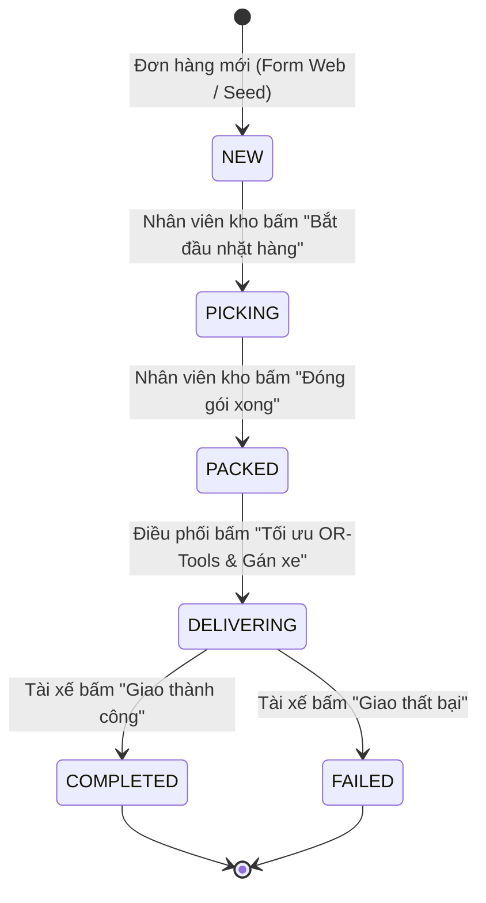

# Delivery Management System (DMS)

---

## Mục Lục

1. [Tổng Quan & Mục Tiêu Dự Án](#1-tổng-quan--mục-tiêu-dự-án)
2. [Kiến Trúc Dự Án](#2-so-sánh-kiến-trúc-enterprise-vs-đồ-án-thu-gọn)
3. [Kiến Trúc Tổng Thể & Cấu Trúc Thư Mục](#3-kiến-trúc-tổng-thể--cấu-trúc-thư-mục)
4. [Vòng Đời Đơn Hàng (Order Lifecycle State Machine)](#4-vòng-đời-đơn-hàng-order-lifecycle-state-machine)
5. [Thiết Kế Cơ Sở Dữ Liệu (PostgreSQL & Prisma Schema)](#5-thiết-kế-cơ-sở-dữ-liệu-postgresql--prisma-schema)
6. [Đặc Tả REST API & Micro-service Google OR-Tools](#6-đặc-tả-rest-api--micro-service-google-or-tools)
7. [Đặc Tả Giao Diện Web Admin Dashboard](#7-đặc-tả-giao-diện-web-admin-dashboard)
8. [Hướng Dẫn Cài Đặt, Khởi Chạy & Kiểm Chứng](#8-hướng-dẫn-cài-đặt-khởi-chạy--kiểm-chứng-docker--local)
9. [Kịch Bản Kiểm Thử](#9-kịch-bản-kiểm-thử--trình-chiếu-báo-cáo-đồ-án-end-to-end-demo)

---

## 1. Tổng Quan & Mục Tiêu Dự Án

Dự án này là phiên bản đồ án của **Hệ thống Quản lý Giao hàng (Delivery Management System - DMS)** phục vụ mô hình bán lẻ đa kênh (Omnichannel Retail Fulfillment).

Mục tiêu chính là **trình diễn trọn vẹn luồng nghiệp vụ xử lý đơn hàng tại kho và giao hàng chặng cuối** một cách trực quan, minh bạch nhất:
- Loại bỏ các thành phần hạ tầng doanh nghiệp phức tạp không cần thiết cho demo học thuật (RabbitMQ, tích hợp webhook 3PL Grab/Ahamove, đối soát két tiền mặt nhiều cấp).
- **Giữ nguyên và làm nổi bật thuật toán cốt lõi:** Tự động gom chuyến và tối ưu hóa thứ tự điểm giao hàng bằng **Google OR-Tools (Vehicle Routing Problem - VRP)** kèm trực quan hóa lộ trình trên bản đồ số **Leaflet OpenStreetMap**.

---

## 2. Kiến Trúc Dự Án

```text
- 1 Monolithic Backend:
  * Node.js (TypeScript) + Express
  * Prisma ORM + PostgreSQL
  * JWT Auth + Switch-Role Menu
- 1 Micro-service Helper:
  * Python FastAPI + Google OR-Tools (VRP Solver)
- Frontend:
  * React 19 (Vite 6) + Meta Astryx Design System (@astryxdesign/core & theme-neutral)
  * Tailwind CSS v4 (Astryx Tailwind Bridge) + Leaflet Map (react-leaflet v5)
```

---

## 3. Kiến Trúc Tổng Thể & Cấu Trúc Thư Mục

### 3.1. Sơ Đồ Kiến Trúc

```text
                       ┌──────────────────────────────────────────────┐
                       │           Web Admin Dashboard (SPA)          │
                       │ (React 19 + Astryx + Tailwind v4 + Leaflet)  │
                       │             http://localhost:5173            │
                       └──────────────────────┬───────────────────────┘
                                              │ HTTP REST (/api/*)
                                              ▼
                       ┌──────────────────────────────────────────────┐
                       │          Node.js Monolith Backend            │
                       │         (Express + TypeScript + Prisma)      │
                       │             http://localhost:3000            │
                       │                                              │
                       │  - Auth & Role Switching (Admin/Kho/Tài xế)  │
                       │  - Order Lifecycle Management.               │
                       │  - Dispatcher & Trip Builder                 │
                       └──────────────┬────────────────┬──────────────┘
                                      │                │
            Prisma Client (SQL queries)                │ HTTP POST /solve-vrp
                                      ▼                ▼
                       ┌────────────────────┐   ┌─────────────────────┐
                       │     PostgreSQL     │   │  Python VRP Solver  │
                       │  (Single Database) │   │  (Google OR-Tools)  │
                       │   localhost:5432   │   │   localhost:8090    │
                       └────────────────────┘   └─────────────────────┘
```

### 3.2. Cấu Trúc Thư Mục Dự Án

```text
doan/
├── docker-compose.yml           # Orchestration cho cả 4 containers (Postgres, Solver, Backend, Frontend)
├── start.sh                     # Script khởi động nhanh toàn bộ hệ thống bằng Docker Compose
├── stop.sh                      # Script dừng toàn bộ hệ thống
├── README.md                    # Tài liệu tổng hợp toàn dự án
├── backend/                     # Node.js Monolithic Backend (:3000)
│   ├── Dockerfile               # Docker image cho Backend
│   ├── docker-entrypoint.sh     # Tự động đồng bộ Prisma schema & khởi chạy server
│   ├── package.json
│   ├── tsconfig.json
│   ├── prisma/
│   │   ├── schema.prisma        # Định nghĩa 7 bảng dữ liệu PostgreSQL (gồm Product & DriverProfile)
│   │   ├── seed.ts              # Script nạp dữ liệu mẫu qua CLI
│   │   └── seed-1000-products.ts # Script sinh 1.000 sản phẩm mẫu vào danh mục kho
│   └── src/
│       ├── index.ts             # Entrypoint Express & tự động seed khi DB/sản phẩm/tài xế trống
│       ├── lib/
│       │   ├── prisma.ts        # Khởi tạo Prisma Client
│       │   └── seeder.ts        # Logic tạo 1 Kho (Depot), Users, 5 Tài xế, 16 Sản phẩm & 10 Đơn hàng mẫu
│       ├── controllers/
│       │   ├── auth.controller.ts    # Login, Me, System Overview, Seed API
│       │   ├── driver.controller.ts  # CRUD tài xế (User + DriverProfile), lọc trạng thái/loại xe & phân trang server
│       │   ├── order.controller.ts   # Tạo/sửa đơn hàng (chọn từ danh mục), chuyển trạng thái & tự giải phóng tài xế
│       │   ├── product.controller.ts # CRUD sản phẩm, thống kê KPI & phân trang phía server
│       │   └── trip.controller.ts    # Gọi Python OR-Tools Solver, gán tài xế & chuyển trạng thái ON_DELIVERY
│       └── routes/
│           ├── auth.routes.ts
│           ├── driver.routes.ts
│           ├── order.routes.ts
│           ├── product.routes.ts
│           └── trip.routes.ts
├── python-solver/               # Micro-service giải bài toán VRP với Google OR-Tools (:8090)
│   ├── Dockerfile               # Docker image cho Python Solver
│   ├── requirements.txt         # Các thư viện Python (fastapi, uvicorn, ortools, pydantic)
│   └── main.py                  # FastAPI endpoint POST /solve-vrp
└── frontend/                    # Giao diện Web Admin Dashboard (:5173)
    ├── Dockerfile               # Multi-stage build (Node 22 Vite Builder -> Nginx Alpine)
    ├── nginx.conf               # Cấu hình Nginx phục vụ SPA & reverse-proxy /api/
    ├── AGENTS.md                # Tài liệu hướng dẫn Astryx cho AI coding agents (generated)
    ├── index.html               # Tích hợp Leaflet CSS
    ├── package.json             # React 19, @astryxdesign/core, theme-neutral, cli, Tailwind v4
    ├── vite.config.ts           # Cấu hình Vite 6 + @tailwindcss/vite
    └── src/
        ├── main.tsx             # Entrypoint (nạp index.css trước để giữ đúng @layer cascade)
        ├── index.css            # Astryx @layer cascade + Tailwind v4 bridge + Leaflet popup styles
        ├── astryx-themes.ts     # Module theme do `astryx theme add neutral` sinh tự động
        ├── App.tsx              # Root <Theme>, <LayerProvider>, điều hướng trang & Toast
        ├── types/
        │   └── dms.ts           # Domain types (Order, Product, Driver, Pagination), metadata & format tiền tệ
        ├── api/
        │   └── dmsApi.ts        # Axios client gọi REST API Backend (Orders, Trips, Products, Drivers)
        └── components/
            ├── Header.tsx                # Top Bar: Chuyển trang Đơn hàng/Sản phẩm/Tài xế, Role, Theme, Seed/New
            ├── OrderTable.tsx            # Action banner OR-Tools (kèm chọn tài xế), TabList lọc trạng thái & bảng đơn
            ├── OrderFormModal.tsx        # Hộp thoại Tạo/Sửa đơn hàng: Mini-map Leaflet + chọn sản phẩm danh mục
            ├── RouteMap.tsx              # Bản đồ Leaflet OSM / CARTO Dark Matter theo theme
            ├── ActiveTripPanel.tsx       # Chi tiết chuyến xe & danh sách điểm dừng tối ưu
            ├── ProductManagementPage.tsx # Trang Quản lý Sản phẩm: KPI, tìm kiếm, lọc danh mục & phân trang server
            ├── ProductFormModal.tsx      # Hộp thoại Astryx Dialog thêm/sửa sản phẩm trong kho
            ├── DriverManagementPage.tsx  # Trang Quản lý Tài xế: KPI, tìm kiếm, lọc trạng thái/loại xe & phân trang server
            └── DriverFormModal.tsx       # Hộp thoại Astryx Dialog thêm/sửa tài khoản & phương tiện tài xế
```

---

## 4. Vòng Đời Đơn Hàng (Order Lifecycle State Machine)

Hệ thống gom gọn quy trình vận hành thành **4 giai đoạn chính (6 mã trạng thái)**:



### Bảng Định Nghĩa Trạng Thái

| Mã Trạng Thái | Tên Trạng Thái | Vai Trò Thực Hiện | Hành Động Kích Hoạt |
| :--- | :--- | :--- | :--- |
| **`NEW`** | Mới tạo | Khách / Admin | Tạo đơn qua form hoặc bấm nút `"Seed 10 Sample Orders"` |
| **`PICKING`** | Đang nhặt hàng | Nhân viên Kho (`WAREHOUSE`) | Nhân viên kho nhận đơn và đi lấy hàng trong kho/siêu thị |
| **`PACKED`** | Đã đóng gói | Nhân viên Kho (`WAREHOUSE`) | Kiểm tra hàng, đóng vào túi/thùng, sẵn sàng chờ điều phối giao |
| **`DELIVERING`**| Đang giao hàng | Điều phối viên (`ADMIN`) | Chọn các đơn `PACKED`, chạy Google OR-Tools và gán chuyến cho tài xế |
| **`COMPLETED`** | Giao thành công | Tài xế (`DRIVER`) | Tài xế đến địa chỉ khách hàng theo thứ tự điểm dừng và xác nhận hoàn tất |
| **`FAILED`** | Giao thất bại | Tài xế (`DRIVER`) | Khách không nhận hàng hoặc không liên lạc được |

---

## 5. Thiết Kế Cơ Sở Dữ Liệu (PostgreSQL & Prisma Schema)

Định nghĩa tại `backend/prisma/schema.prisma`:

```prisma
datasource db {
  provider = "postgresql"
  url      = env("DATABASE_URL")
}

generator client {
  provider = "prisma-client-js"
}

enum Role {
  ADMIN
  WAREHOUSE
  DRIVER
}

enum OrderStatus {
  NEW
  PICKING
  PACKED
  DELIVERING
  COMPLETED
  FAILED
}

enum DriverStatus {
  AVAILABLE
  ON_DELIVERY
  OFFLINE
}

model User {
  id            Int            @id @default(autoincrement())
  email         String         @unique
  password      String
  name          String
  role          Role           @default(WAREHOUSE)
  driverProfile DriverProfile?
  trips         Trip[]
  createdAt     DateTime       @default(now())
}

model DriverProfile {
  id           Int          @id @default(autoincrement())
  userId       Int          @unique
  user         User         @relation(fields: [userId], references: [id], onDelete: Cascade)
  phone        String
  vehicleType  String       @default("Xe máy")
  licensePlate String
  status       DriverStatus @default(AVAILABLE)
  isActive     Boolean      @default(true)
  notes        String?
  createdAt    DateTime     @default(now())
  updatedAt    DateTime     @updatedAt
}

model Store {
  id        Int      @id @default(autoincrement())
  name      String
  address   String
  latitude  Float    // Điểm xuất phát (Depot) cho thuật toán VRP
  longitude Float
  orders    Order[]
  trips     Trip[]
}

model Order {
  id               Int         @id @default(autoincrement())
  orderCode        String      @unique
  storeId          Int
  store            Store       @relation(fields: [storeId], references: [id])
  customerName     String
  customerPhone    String
  customerAddress  String
  latitude         Float       // Tọa độ GPS khách hàng
  longitude        Float
  totalAmount      Decimal     @db.Decimal(10, 2)
  status           OrderStatus @default(NEW)
  items            OrderItem[]
  tripId           Int?
  trip             Trip?       @relation(fields: [tripId], references: [id])
  deliverySequence Int?        // Thứ tự dừng xe do OR-Tools tối ưu (1, 2, 3...)
  createdAt        DateTime    @default(now())
  updatedAt        DateTime    @updatedAt
}

model OrderItem {
  id          Int     @id @default(autoincrement())
  orderId     Int
  order       Order   @relation(fields: [orderId], references: [id], onDelete: Cascade)
  productId   Int?
  sku         String?
  productName String
  quantity    Int
  price       Decimal @db.Decimal(10, 2)
}

model Trip {
  id            Int      @id @default(autoincrement())
  tripCode      String   @unique
  storeId       Int
  store         Store    @relation(fields: [storeId], references: [id])
  driverId      Int?
  driver        User?    @relation(fields: [driverId], references: [id])
  orders        Order[]
  status        String   @default("ASSIGNED") // ASSIGNED | IN_TRANSIT | COMPLETED
  totalDistance Float?   // Tổng quãng đường tối ưu (mét)
  createdAt     DateTime @default(now())
}

model Product {
  id        Int      @id @default(autoincrement())
  sku       String   @unique
  name      String
  category  String   @default("Thực phẩm")
  unit      String   @default("Cái")
  price     Decimal  @db.Decimal(10, 2)
  stock     Int      @default(0)
  isActive  Boolean  @default(true)
  createdAt DateTime @default(now())
  updatedAt DateTime @updatedAt
}
```

---

## 6. Đặc Tả REST API & Micro-service Google OR-Tools

### 6.1. Backend Node.js REST API (`http://localhost:3000/api`)

#### Xác thực & Hệ thống
- `GET /api/health`: Kiểm tra trạng thái hoạt động của Backend.
- `POST /api/auth/login`: Đăng nhập (`{ email, password }`), trả về JWT token và thông tin tài khoản.
- `GET /api/auth/me`: Lấy thông tin tài khoản hiện tại.
- `GET /api/system/overview`: Lấy danh sách Kho (`stores`) và Người dùng (`users`).
- `POST /api/seed`: Reset và nạp lại dữ liệu mẫu gồm:
  - **1 Kho xuất phát (Depot):** `Lotte Mart Quận 7 (Depot)` (`10.7423, 106.7024`)
  - **3 Tài khoản mẫu chính + 5 Tài xế mẫu kèm hồ sơ phương tiện (`DriverProfile`):**
    - `admin@dms.vn` (Mật khẩu: `123`, Role: `ADMIN`)
    - `kho@dms.vn` (Mật khẩu: `123`, Role: `WAREHOUSE`)
    - `taixe@dms.vn`, `taixe.binh@dms.vn`, `taixe.cuong@dms.vn`, `taixe.dung@dms.vn`, `taixe.hung@dms.vn` (Mật khẩu: `123`, Role: `DRIVER`)
  - **10 Đơn hàng mẫu (`ORD-101` ➔ `ORD-110`)** có tọa độ GPS thực tế quanh khu vực Quận 7, Quận 4, Nhà Bè.

#### Quản lý Đơn hàng
- `GET /api/orders`: Danh sách đơn hàng (hỗ trợ lọc `?status=NEW|PICKING|PACKED|DELIVERING|COMPLETED|FAILED`).
- `GET /api/orders/:id`: Xem chi tiết đơn hàng và danh sách sản phẩm (`items`).
- `POST /api/orders`: Tạo đơn hàng mới. Sản phẩm trong đơn phải được chọn từ danh mục `Product`; backend tự tra cứu `productName`, `sku`, `price` từ danh mục và tự tính `totalAmount`.
- `PUT /api/orders/:id`: Chỉnh sửa đơn hàng (chỉ cho phép ở các trạng thái trước điều phối: `NEW`, `PICKING`, `PACKED`; trả về `400` nếu đơn đã `DELIVERING`, `COMPLETED` hoặc `FAILED`). Cập nhật thông tin khách hàng, tọa độ GPS và danh sách `OrderItem` (giữ nguyên `status`, tự tính lại `totalAmount`).
- `PATCH /api/orders/:id/start-picking`: Chuyển trạng thái đơn từ `NEW` ➔ `PICKING`.
- `PATCH /api/orders/:id/complete-packing`: Chuyển trạng thái đơn từ `PICKING` ➔ `PACKED`.

#### Quản lý Sản phẩm (Product Catalog & Server-Side Pagination)
- `GET /api/products`: Danh sách sản phẩm hỗ trợ phân trang phía server (`?page=1&limit=20`, giới hạn `1–100`), tìm kiếm theo tên/SKU/danh mục (`?search=`), lọc danh mục (`?category=`), và lọc sản phẩm đang bán (`?activeOnly=true`). Trả về `data`, `pagination` (`page`, `limit`, `total`, `totalPages`) và `summary` (`totalProducts`, `activeProducts`, `lowStockProducts`, `totalStock`).
- `GET /api/products/:id`: Xem chi tiết một sản phẩm.
- `POST /api/products`: Tạo sản phẩm mới (tự sinh mã `SKU-...` nếu bỏ trống, kiểm tra trùng SKU với mã lỗi `409`).
- `PUT /api/products/:id`: Cập nhật thông tin sản phẩm (SKU, tên, danh mục, đơn vị tính, giá bán, tồn kho, trạng thái kinh doanh `isActive`).
- `DELETE /api/products/:id`: Xóa sản phẩm khỏi danh mục.

#### Quản lý Tài xế (Driver Management & Fleet Status)
- `GET /api/drivers`: Danh sách tài xế (gộp thông tin `User` + `DriverProfile` + chuyến đang chạy `activeTrip` + `totalTrips`), hỗ trợ phân trang phía server (`?page=1&limit=20`), tìm kiếm theo tên/email/SĐT/biển số (`?search=`), lọc trạng thái (`?status=AVAILABLE|ON_DELIVERY|OFFLINE`), lọc loại xe (`?vehicleType=`), và lọc nhanh tài xế sẵn sàng (`?availableOnly=true`). Trả về `data`, `pagination` và `summary` (`totalDrivers`, `availableDrivers`, `onDeliveryDrivers`, `inactiveDrivers`).
- `GET /api/drivers/:id`: Xem chi tiết một tài xế.
- `POST /api/drivers`: Tạo tài khoản tài xế (`role: DRIVER`, mật khẩu mặc định `123` nếu bỏ trống) cùng bản ghi `DriverProfile` (`phone`, `vehicleType`, `licensePlate`, `status`, `isActive`, `notes`), kiểm tra trùng email với mã lỗi `409`.
- `PUT /api/drivers/:id`: Cập nhật thông tin tài khoản, mật khẩu tùy chọn, phương tiện, trạng thái vận hành và cờ hoạt động `isActive`.
- `DELETE /api/drivers/:id`: Chặn xóa (`400`) nếu tài xế đang có chuyến `ASSIGNED` hoặc `IN_TRANSIT`; với các chuyến đã hoàn tất, tự động gỡ liên kết (`Trip.driverId = null`) trước khi xóa `User` (cascade sang `DriverProfile`).

#### Điều phối & Tối ưu Lộ trình (OR-Tools Integration)
- `POST /api/trips/optimize`:
  - **Input:** `{ "storeId": 1, "orderIds": [1, 2, 3], "driverId": 3 }` (`driverId` tùy chọn — nếu bỏ trống sẽ ưu tiên tự động chọn tài xế `AVAILABLE` đang hoạt động).
  - **Luồng xử lý:**
    1. Truy vấn tọa độ Depot (`Store`), kiểm tra tài xế hợp lệ và lấy tọa độ các đơn hàng `PACKED` được chọn.
    2. Gọi `POST http://python-solver:8090/solve-vrp`.
    3. Nhận danh sách điểm dừng đã sắp xếp tối ưu (`sequence: 1, 2, 3...`) và tổng quãng đường (`total_distance_meters`).
    4. Khởi tạo bản ghi `Trip`, cập nhật trạng thái tài xế sang `ON_DELIVERY`, cập nhật `tripId`, `deliverySequence` và chuyển trạng thái các đơn hàng sang `DELIVERING`.
- `GET /api/trips`: Danh sách các chuyến xe.
- `GET /api/trips/my-active`: Lấy chuyến xe đang thực hiện (hoặc chuyến mới nhất) để hiển thị lộ trình trên bản đồ.

#### Thực thi Giao hàng (Driver Execution)
- `PATCH /api/orders/:id/complete-delivery`: Chuyển trạng thái đơn sang `COMPLETED` (tự động hoàn tất `Trip` khi toàn bộ đơn trong chuyến đã giao xong và tự động chuyển tài xế về `AVAILABLE` nếu không còn chuyến hoạt động khác).
- `PATCH /api/orders/:id/fail-delivery`: Chuyển trạng thái đơn sang `FAILED` (tự động hoàn tất `Trip` và giải phóng tài xế về `AVAILABLE` nếu là đơn cuối cùng của chuyến).

---

### 6.2. Micro-service Python Google OR-Tools VRP Solver (`http://localhost:8090`)

- **Công nghệ:** Python, FastAPI, Uvicorn, `ortools.constraint_solver.pywrapcp`.
- **Chiến lược giải:** `FirstSolutionStrategy.PATH_CHEAPEST_ARC` kết hợp `LocalSearchMetaheuristic.GUIDED_LOCAL_SEARCH`.
- **Endpoint:** `POST /solve-vrp`

#### Request Payload Mẫu:
```json
{
  "depot": { "lat": 10.7423, "lng": 106.7024 },
  "orders": [
    { "order_id": 1, "lat": 10.7480, "lng": 106.6980 },
    { "order_id": 2, "lat": 10.7450, "lng": 106.7050 },
    { "order_id": 3, "lat": 10.7380, "lng": 106.7110 }
  ],
  "num_vehicles": 1
}
```

#### Response Payload Mẫu:
```json
{
  "status": "SUCCESS",
  "routes": [
    {
      "vehicle_id": 0,
      "stops": [
        { "order_id": 3, "sequence": 1, "lat": 10.738, "lng": 106.711, "distance_from_prev_meters": 1067 },
        { "order_id": 2, "sequence": 2, "lat": 10.745, "lng": 106.705, "distance_from_prev_meters": 1023 },
        { "order_id": 1, "sequence": 3, "lat": 10.748, "lng": 106.698, "distance_from_prev_meters": 845 }
      ],
      "total_distance_meters": 3734
    }
  ]
}
```

---

## 7. Đặc Tả Giao Diện Web Admin Dashboard

Giao diện đơn trang (SPA) tại `http://localhost:5173` được xây dựng bằng **Meta Astryx Design System** (`@astryxdesign/core`, `@astryxdesign/theme-neutral`) kết hợp **Tailwind CSS v4** (qua Astryx Tailwind Bridge `@astryxdesign/core/tailwind-theme.css` và thứ tự `@layer` chuẩn), hỗ trợ đầy đủ **Light / System / Dark mode** và chia làm 3 khu vực trực quan:

1. **Thanh Công Cụ Trên Cùng (Top Bar — `Header.tsx`):**
   - **Page Switcher (`SegmentedControl`):** Chuyển đổi nhanh giữa 3 trang quản lý chính — **Đơn hàng** (`#orders`), **Sản phẩm** (`#products`) và **Tài xế** (`#drivers`), hiển thị tổng số lượng tương ứng.
   - **Role Switcher (`Selector`):** Chuyển đổi tức thì giữa 3 vai trò (`Quản lý / Điều phối - ADMIN`, `Nhân viên Kho - WAREHOUSE`, `Tài xế Giao hàng - DRIVER`) mà không cần đăng xuất/đăng nhập lại.
   - **Theme Mode Switcher (`SegmentedControl`):** Chuyển đổi chế độ giao diện **Sáng / Hệ thống / Tối** (lưu trong `localStorage`), tự động đồng bộ toàn bộ token màu Astryx và lớp bản đồ Leaflet.
   - **Tạo đơn mới (`Button` + `Dialog`):** Mở hộp thoại thống nhất cho cả Tạo và Sửa đơn hàng (`OrderFormModal.tsx`).
   - **Seed 10 Sample Orders (`Button`):** Khôi phục/nạp nhanh 10 đơn hàng mẫu ở trạng thái `NEW` để bắt đầu buổi thuyết trình.
2. **Bảng Điều Phối, Tạo & Chỉnh Sửa Đơn Hàng (`OrderTable.tsx` & `OrderFormModal.tsx`):**
   - Các tab lọc đơn hàng theo trạng thái (`TabList` / `Tab`) kèm số lượng thực tế và chọn tất cả đơn `PACKED` (`CheckboxInput` hỗ trợ trạng thái `indeterminate`).
   - Nút tiện ích **"Đóng gói nhanh"** giúp chuyển nhanh các đơn `NEW`/`PICKING` sang `PACKED` khi muốn demo ngay thuật toán OR-Tools.
   - Bộ chọn **Tài xế giao hàng (`Selector`)** hiển thị danh sách tài xế đang sẵn sàng (`AVAILABLE`) kèm loại xe & biển số (hoặc tự động chọn) ngay cạnh nút **"Tối ưu hóa lộ trình với Google OR-Tools"**.
   - Bảng đơn hàng (`Table`, `Badge`, `Button`, `IconButton`) với nút **Chỉnh sửa đơn hàng** (hiện cho `ADMIN` và `WAREHOUSE` với các đơn ở trạng thái `NEW`, `PICKING`, `PACKED`; ẩn với `DRIVER`) cùng các nút chuyển trạng thái và thông báo `useToast()`.
   - **Hộp thoại Tạo/Sửa Đơn Hàng (`OrderFormModal.tsx`):**
     - Sử dụng cấu trúc Astryx `Dialog` + `Layout` (`LayoutContent` / `LayoutFooter`) để nút Lưu/Hủy luôn cố định ở chân hộp thoại.
     - **Bản đồ mini Leaflet tương tác:** Click lên bản đồ hoặc kéo ghim xanh để chọn tọa độ giao hàng, đồng bộ 2 chiều với ô nhập `Latitude` / `Longitude`.
     - **Chọn sản phẩm bắt buộc từ danh mục:** Ô tìm kiếm theo tên hoặc mã SKU gọi trực tiếp API danh mục sản phẩm đang kinh doanh; bấm **Thêm** để đưa vào đơn (tự tăng `Qty` nếu đã có).
     - **Bảng Order Item 4 cột:** `Tên sản phẩm`, `SKU`, `Giá` (chỉ đọc) và `Qty` (cột duy nhất cho phép sửa, kèm nút xóa dòng và tổng tiền tự tính).
3. **Bản Đồ Lộ Trình Leaflet & Chi Tiết Chuyến Xe (Bên phải — `RouteMap.tsx` & `ActiveTripPanel.tsx`):**
   - Tự động chuyển đổi tile bản đồ giữa **OpenStreetMap** (chế độ sáng) và **CARTO Dark Matter** (chế độ tối).
   - Hiển thị Marker **Kho xuất phát (Depot)** màu đỏ (`🏪`).
   - Hiển thị các điểm giao hàng bằng Marker tròn đánh số thứ tự dừng xe **`1, 2, 3...`** theo kết quả của Google OR-Tools.
   - Vẽ đường nối **Polyline** từ `Depot ➔ Stop #1 ➔ Stop #2 ➔ Stop #3...`.
   - Thẻ thông tin chuyến xe (`Card`) bên dưới bản đồ hiển thị mã chuyến (`TRIP-...`), tên tài xế, tổng quãng đường (`km`/`m`) và danh sách các điểm dừng theo thứ tự.
4. **Trang Quản Lý Sản Phẩm (`ProductManagementPage.tsx` & `ProductFormModal.tsx`):**
   - **4 thẻ KPI tổng quan:** Tổng sản phẩm, Đang kinh doanh, Sắp hết hàng (`<= 10`), Tổng số lượng tồn kho (tính toàn kho từ API `summary`).
   - **Tìm kiếm & Lọc:** Tìm kiếm theo tên/SKU (debounce `250ms`) và lọc theo danh mục sản phẩm.
   - **Phân trang phía server (`@astryxdesign/core/Pagination`):** Điều hướng theo số trang kèm dấu `...`, nút Trước/Sau và bộ chọn số dòng mỗi trang (`10 / 20 / 50 / 100`).
   - **Thao tác CRUD:** Thêm sản phẩm, chỉnh sửa (`ProductFormModal.tsx`), bật/tắt trạng thái đang bán và xóa sản phẩm có hộp thoại xác nhận (dành cho `ADMIN` & `WAREHOUSE`; `DRIVER` ở chế độ chỉ xem).
5. **Trang Quản Lý Tài Xế (`DriverManagementPage.tsx` & `DriverFormModal.tsx`):**
   - **4 thẻ KPI tổng quan:** Tổng tài xế, Đang sẵn sàng (`AVAILABLE`), Đang giao hàng (`ON_DELIVERY`), Ngừng hoạt động (tính từ API `summary`).
   - **Tìm kiếm & Lọc:** Tìm kiếm theo tên/SĐT/email/biển số (debounce `250ms`), lọc theo trạng thái vận hành (`AVAILABLE`, `ON_DELIVERY`, `OFFLINE`) và loại xe (`Xe máy`, `Xe tải nhỏ`, `Xe van`).
   - **Thông tin chuyến giao & Phân trang server:** Hiển thị mã chuyến đang chạy (`TRIP-...`) cùng tổng số chuyến của mỗi tài xế, hỗ trợ phân trang phía server (`10 / 20 / 50 / 100`).
   - **Phân quyền & Thao tác CRUD:** Chỉ `ADMIN` được thêm, chỉnh sửa (`DriverFormModal.tsx`), bật/tắt hoạt động và xóa tài xế (tự động khóa nút xóa khi tài xế đang có chuyến hoạt động); `WAREHOUSE` và `DRIVER` ở chế độ chỉ xem.

---

## 8. Hướng Dẫn Cài Đặt, Khởi Chạy & Kiểm Chứng

### 8.1. Khởi Chạy Toàn Bộ Hệ Thống

Toàn bộ 4 dịch vụ (`postgres`, `python-solver`, `backend`, `frontend`) đã được đóng gói Docker.

#### Khởi động hệ thống:
```bash
./start.sh
# Hoặc chạy trực tiếp:
docker compose up -d --build
```

#### Kiểm tra trạng thái các container:
```bash
docker compose ps
```

#### Tắt hệ thống:
```bash
./stop.sh
# Hoặc chạy trực tiếp:
docker compose stop
```

---

### 8.2. Các Lệnh Tự Kiểm Chứng (Self-Verification bằng cURL)

```bash
# 1. Kiểm tra sức khỏe Backend & Python Solver
curl http://localhost:3000/api/health
curl http://localhost:8090/

# 2. Nạp 10 đơn hàng mẫu
curl -X POST http://localhost:3000/api/seed

# 3. Chuyển đơn số 1 sang PICKING rồi PACKED
curl -X PATCH http://localhost:3000/api/orders/1/start-picking
curl -X PATCH http://localhost:3000/api/orders/1/complete-packing

# 4. Gọi tối ưu hóa lộ trình với Google OR-Tools
curl -X POST http://localhost:3000/api/trips/optimize \
  -H "Content-Type: application/json" \
  -d '{"storeId": 1, "orderIds": [1]}'

# 5. Tài xế xác nhận giao hàng thành công
curl -X PATCH http://localhost:3000/api/orders/1/complete-delivery

# 6. Truy vấn danh sách sản phẩm có phân trang & tìm kiếm
curl "http://localhost:3000/api/products?page=1&limit=20&search=G%E1%BA%A1o"

# 7. Truy vấn danh sách tài xế đang sẵn sàng
curl "http://localhost:3000/api/drivers?page=1&limit=20&status=AVAILABLE"
```

#### Nạp nhanh 1.000 sản phẩm mẫu để kiểm thử phân trang:
```bash
npm --prefix backend run db:push
npm --prefix backend run seed:products1000
```

---

### 8.3. Phát Triển Frontend & Astryx CLI (Local)

Yêu cầu **Node.js `>= 22.13.0`** khi chạy frontend ở chế độ local:

```bash
cd frontend
npm install

# Khởi chạy Vite dev server (http://localhost:5173)
npm run dev

# Kiểm tra TypeScript & build production
npm run build

# Kiểm tra cấu hình Astryx Design System
npm run astryx -- doctor

# Tra cứu tài liệu component của Astryx (VD: Button, Dialog, Table)
npm run astryx -- component Button
```

> Tài liệu hướng dẫn sử dụng Astryx dành cho AI coding agents được sinh tự động tại `frontend/AGENTS.md`.

---

## 9. Kịch Bản Kiểm Thử

Thực hiện tuần tự 4 bước sau trên giao diện **`http://localhost:5173`**:

1. **Bước 1 — Khởi tạo dữ liệu:**
   - Mở Dashboard: Kho trung tâm (**Lotte Mart Quận 7 - Depot**) xử lý đơn hàng và giao chặng cuối (Last-mile delivery).
   - Bấm nút **"Seed 10 Sample Orders"** trên góc phải ➔ 10 đơn hàng xuất hiện ở trạng thái `NEW` và hiển thị vị trí quanh kho trên bản đồ.

2. **Bước 2 — Nghiệp vụ Kho (Warehouse Fulfillment):**
   - Chọn vai trò **"📦 Nhân viên Kho (WAREHOUSE)"** trên thanh công cụ.
   - Bấm **"Bắt đầu nhặt hàng"** trên một vài đơn ➔ Trạng thái chuyển sang `PICKING`.
   - Bấm **"Đóng gói xong"** (hoặc bấm nút **"Đóng gói nhanh"**) ➔ Trạng thái chuyển sang `PACKED`.

3. **Bước 3 — Điểm nhấn Thuật toán Google OR-Tools VRP:**
   - Chuyển vai trò sang **"👑 Quản lý / Điều phối (ADMIN)"**.
   - Tick chọn các đơn hàng `PACKED` và bấm nút **"⚡ Tối ưu hóa lộ trình với Google OR-Tools"**.
   - Giải thích: Backend gửi tọa độ Kho và các đơn hàng sang micro-service Python FastAPI chạy thuật toán **Google OR-Tools** để tìm hành trình ngắn nhất.
   - Quan sát trên bản đồ Leaflet: Hệ thống tự động đánh số thứ tự giao hàng `#1, #2, #3...`, vẽ đường nối lộ trình Polyline và hiển thị tổng quãng đường di chuyển tối ưu.

4. **Bước 4 — Tài xế Giao hàng Chặng cuối (Driver Execution):**
   - Chuyển vai trò sang **"🛵 Tài xế Giao hàng (DRIVER)"**.
   - Xem danh sách điểm dừng đã được sắp xếp theo đúng thứ tự `Stop #1, Stop #2, Stop #3...`.
   - Bấm **"Giao thành công"** cho từng đơn theo thứ tự lộ trình ➔ Trạng thái đơn chuyển sang `COMPLETED` (màu xanh lá trên cả bảng và bản đồ) và chuyến xe tự động hoàn tất.
