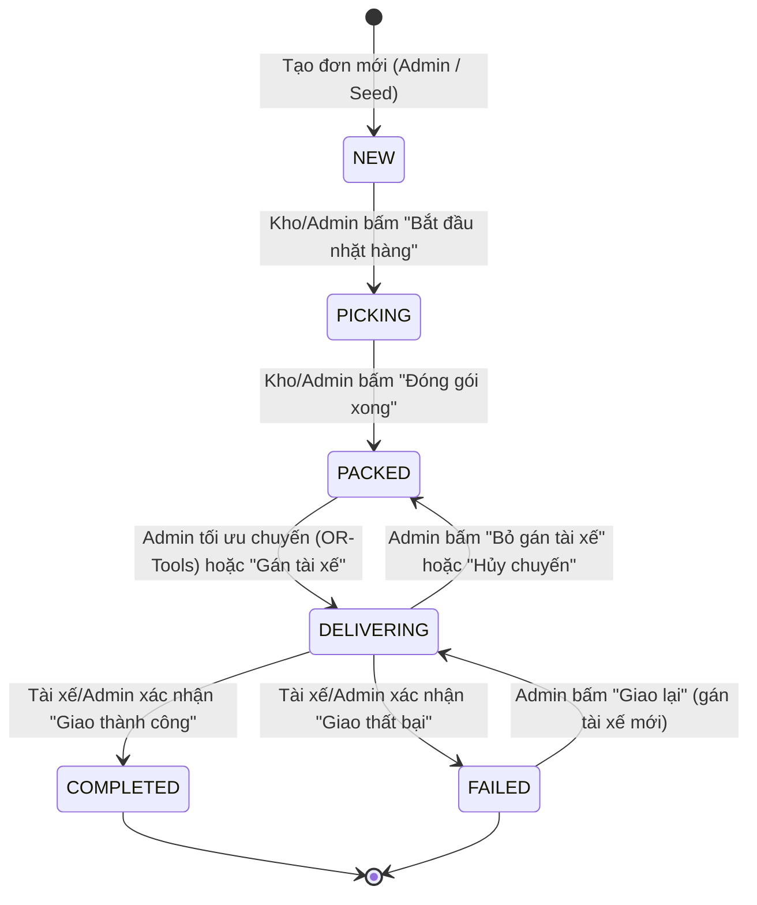

# Delivery Management System (DMS)

Hệ thống **Quản lý Giao hàng (Delivery Management System - DMS)** phục vụ mô hình bán lẻ đa kênh (Omnichannel Retail Fulfillment), tập trung trình diễn trọn vẹn luồng nghiệp vụ xử lý đơn hàng tại kho và giao hàng chặng cuối (Last-Mile Delivery).

---

## 1. Tổng Quan & Mục Tiêu Nghiệp Vụ

DMS giải quyết bài toán vận hành giao hàng nội thành từ nhiều điểm xuất phát (Multi-Depot) đến tay khách hàng:

- **Trực quan hóa trọn vẹn vòng đời đơn hàng:** Từ lúc tiếp nhận đơn (`NEW`), nhặt hàng (`PICKING`), đóng gói (`PACKED`), điều phối gom chuyến (`DELIVERING`) đến khi hoàn tất (`COMPLETED`) hoặc giao thất bại (`FAILED`).
- **Tối ưu hóa lộ trình giao hàng (VRP):** Tự động gom nhiều đơn đã đóng gói thành chuyến xe và tính toán thứ tự giao hàng ngắn nhất bằng **Google OR-Tools**, hiển thị trực tiếp trên bản đồ số.
- **Phạm vi đồ án tinh gọn:** Loại bỏ các thành phần hạ tầng doanh nghiệp phức tạp không cần thiết cho demo học thuật (message broker, webhook 3PL bên thứ ba, đối soát két tiền mặt nhiều cấp) để tập trung làm nổi bật nghiệp vụ cốt lõi và thuật toán định tuyến.

---

## 2. Quy Tắc Nghiệp Vụ Cốt Lõi

| Nghiệp vụ | Quy tắc áp dụng |
| :--- | :--- |
| **Đa điểm xuất phát (Multi-Depot)** | Hệ thống hỗ trợ nhiều kho/cửa hàng xuất phát (`Store`). Luôn có duy nhất **1 kho mặc định** đang hoạt động. Không thể xóa kho mặc định hoặc kho còn đơn hàng, chuyến xe, hay tài xế gắn liền. |
| **Bán kính giao hàng ≤ 5 km** | Mọi đơn hàng mới/chỉnh sửa và mọi chuyến xe tối ưu đều bị **chặn cứng** nếu khoảng cách từ kho xuất phát đến địa chỉ khách hàng vượt quá **5 km** (tính theo công thức Haversine). |
| **Tồn kho theo từng Depot** | Mỗi kho quản lý số lượng tồn riêng cho từng sản phẩm (`DepotStock`). Khi tạo đơn, hệ thống kiểm tra và trừ tồn kho ngay tại kho xuất phát (chống âm kho); khi sửa đơn/đổi kho hoặc giao thất bại, tồn kho được tự động hoàn/điều chỉnh tương ứng; khi giao lại đơn thất bại, tồn kho được trừ lại. |
| **Đội ngũ Tài xế gắn Depot** | Mỗi tài xế thuộc về **1 depot cố định**. Tài xế chỉ được gán đơn hàng và chạy chuyến xuất phát từ đúng depot của mình. Không thể đổi depot hoặc xóa tài xế khi đang có chuyến hoạt động. |
| **Gom chuyến & Tối ưu lộ trình** | Điều phối viên có thể gom các đơn `PACKED` cùng depot (trong bán kính ≤ 5 km) để chạy tối ưu lộ trình (gán thứ tự điểm dừng `#1, #2, #3...`), hoặc gán trực tiếp tài xế vào từng đơn. Khi toàn bộ đơn trong chuyến đã `COMPLETED`/`FAILED`, chuyến tự động đóng `COMPLETED` và giải phóng tài xế về `AVAILABLE`. |

---

## 3. Vòng Đời Đơn Hàng (Order Lifecycle)

Quy trình vận hành được chuẩn hóa thành **4 giai đoạn chính** với **6 trạng thái**:



| Mã Trạng Thái | Tên Trạng Thái | Vai Trò Thực Hiện | Ý Nghĩa Nghiệp Vụ |
| :--- | :--- | :--- | :--- |
| **`NEW`** | Mới tạo | `ADMIN` | Đơn hàng vừa được tạo mới, chờ kho tiếp nhận và trừ tồn kho tại depot |
| **`PICKING`** | Đang nhặt hàng | `WAREHOUSE`, `ADMIN` | Nhân viên kho đang đi lấy sản phẩm theo danh sách đơn trong kho |
| **`PACKED`** | Đã đóng gói | `WAREHOUSE`, `ADMIN` | Hàng đã kiểm đếm, đóng gói xong, sẵn sàng chờ điều phối gom chuyến |
| **`DELIVERING`** | Đang giao hàng | `ADMIN` | Đã được gom vào chuyến tối ưu hoặc gán trực tiếp cho tài xế cùng depot |
| **`COMPLETED`** | Giao thành công | `DRIVER`, `ADMIN` | Tài xế đã giao hàng thành công cho khách theo thứ tự điểm dừng |
| **`FAILED`** | Giao thất bại | `DRIVER`, `ADMIN` | Khách không nhận hàng hoặc không liên lạc được (hoàn tồn kho; có thể gán lại để giao lại) |

---

## 4. Vai Trò Người Dùng & Phân Quyền Nghiệp Vụ

Hệ thống hỗ trợ **3 vai trò** với cơ chế phân quyền và giới hạn phạm vi dữ liệu (Data Scoping):

| Nghiệp vụ / Tài nguyên | Quản trị & Điều phối (`ADMIN`) | Nhân viên Kho (`WAREHOUSE`) | Tài xế (`DRIVER`) |
| :--- | :---: | :---: | :---: |
| **Đơn hàng** — Xem | Tất cả | Tất cả | Chỉ đơn thuộc chuyến của mình |
| **Đơn hàng** — Tạo / Sửa / Gán & Bỏ gán tài xế | Có | Không | Không |
| **Đơn hàng** — Nhặt hàng / Đóng gói (đơn lẻ & hàng loạt) | Có | Có | Không |
| **Đơn hàng** — Xác nhận Giao thành công / Thất bại | Có | Không | Chỉ đơn thuộc chuyến của mình |
| **Chuyến xe** — Xem | Tất cả | Tất cả (chỉ xem) | Chỉ chuyến được gán |
| **Chuyến xe** — Tối ưu / Đổi tài xế / Tối ưu lại / Hủy | Có | Không | Không |
| **Chuyến xe** — Bắt đầu xuất phát (`IN_TRANSIT`) | Có | Không | Chỉ chuyến được gán |
| **Sản phẩm** — Xem danh mục & tồn kho | Có | Có (chỉ xem) | Không |
| **Sản phẩm** — Thêm / Sửa / Xóa | Có | Không | Không |
| **Điểm xuất phát (Depot)** — Xem & Cập nhật tồn kho | Có | Có | Xem thông tin cơ bản |
| **Điểm xuất phát (Depot)** — Thêm / Sửa / Xóa / Đặt mặc định | Có | Không | Không |
| **Tài xế** — Quản lý đội ngũ & phương tiện | Có | Không | Không |
| **Tài khoản người dùng** & **Khởi tạo dữ liệu mẫu** | Có | Không | Không |

---

## 5. Khởi Chạy Nhanh (Quick Start)

Yêu cầu cài đặt **Docker** và **Docker Compose**:

```bash
./start.sh        # Khởi động toàn bộ 4 dịch vụ (PostgreSQL, Solver, Backend, Frontend)
./stop.sh         # Dừng hệ thống
```

- **Web Admin Dashboard:** `http://localhost:5173`
- **Backend API:** `http://localhost:3000/api/health`
- **Python VRP Solver:** `http://localhost:8090/`

**Tài khoản mẫu** (mật khẩu chung: `123456`):

| Vai trò | Email đăng nhập |
| :--- | :--- |
| Quản trị & Điều phối (`ADMIN`) | `admin@dms.vn` |
| Nhân viên Kho (`WAREHOUSE`) | `kho@dms.vn` |
| Tài xế (`DRIVER`) | `taixe@dms.vn` *(cùng `taixe.binh`, `taixe.cuong`, `taixe.dung`, `taixe.hung` `@dms.vn`)* |

---

## 6. Tài Liệu Kỹ Thuật

Các thông tin chi tiết về kiến trúc, cơ sở dữ liệu, API, hướng dẫn phát triển và triển khai được tách riêng thành các tài liệu chuyên biệt:

| Tài liệu | Nội dung chính |
| :--- | :--- |
| [**docs/ARCHITECTURE.md**](docs/ARCHITECTURE.md) | Tech stack, sơ đồ kiến trúc, cấu trúc thư mục, sơ đồ ER cơ sở dữ liệu & đặc tả giao diện Web Dashboard |
| [**docs/API.md**](docs/API.md) | Cơ chế xác thực JWT/Refresh Token, đặc tả toàn bộ REST API Backend & micro-service Google OR-Tools VRP |
| [**docs/DEVELOPMENT.md**](docs/DEVELOPMENT.md) | Hướng dẫn cài đặt Docker/Local, CLI nạp dữ liệu mẫu, bộ lệnh cURL tự kiểm chứng & kịch bản demo End-to-End |
| [**infra/DEPLOY_AZURE.md**](infra/DEPLOY_AZURE.md) | Kiến trúc Azure (Static Web Apps, Container Apps, PostgreSQL Flexible Server), Bicep IaC & CI/CD OIDC |
