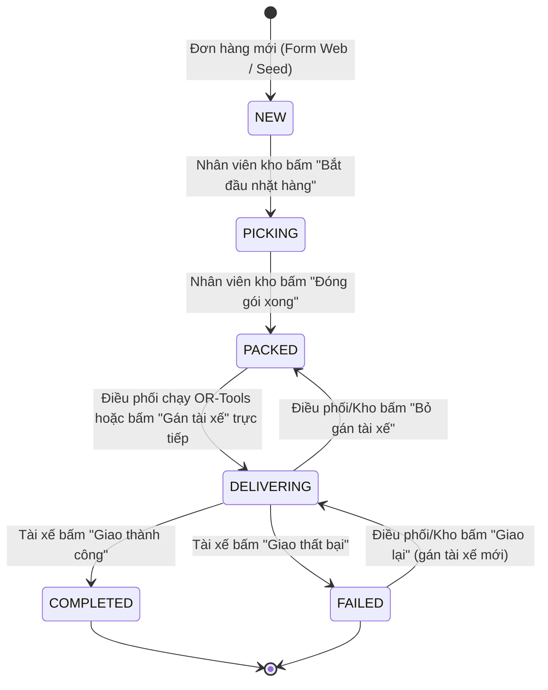

# Delivery Management System (DMS)

---

## Mục Lục

1. [Tổng Quan & Mục Tiêu Dự Án](#1-tổng-quan--mục-tiêu-dự-án)
2. [Kiến Trúc Dự Án](#2-so-sánh-kiến-trúc-enterprise-vs-đồ-án-thu-gọn)
3. [Kiến Trúc Tổng Thể & Cấu Trúc Thư Mục](#3-kiến-trúc-tổng-thể--cấu-trúc-thư-mục)
4. [Vòng Đời Đơn Hàng (Order Lifecycle State Machine)](#4-vòng-đời-đơn-hàng-order-lifecycle-state-machine)
5. [Thiết Kế Cơ Sở Dữ Liệu (PostgreSQL & Prisma Schema)](#5-thiết-kế-cơ-sở-dữ-liệu-postgresql--prisma-schema)
6. [Đặc Tả REST API & Micro-service Google OR-Tools](#6-đặc-tả-rest-api--micro-service-google-or-tools)
7. [Đặc Tả Giao Diện Web Admin Dashboard](#7-đặc-tả-giao-diện-web-admin-dashboard)
8. [Hướng Dẫn Cài Đặt, Khởi Chạy & Kiểm Chứng](#8-hướng-dẫn-cài-đặt-khởi-chạy--kiểm-chứng-docker--local)
9. [Kịch Bản Kiểm Thử](#9-kịch-bản-kiểm-thử--trình-chiếu-báo-cáo-đồ-án-end-to-end-demo)

---

## 1. Tổng Quan & Mục Tiêu Dự Án

Dự án này là phiên bản đồ án của **Hệ thống Quản lý Giao hàng (Delivery Management System - DMS)** phục vụ mô hình bán lẻ đa kênh (Omnichannel Retail Fulfillment).

Mục tiêu chính là **trình diễn trọn vẹn luồng nghiệp vụ xử lý đơn hàng tại kho và giao hàng chặng cuối** một cách trực quan, minh bạch nhất:
- Loại bỏ các thành phần hạ tầng doanh nghiệp phức tạp không cần thiết cho demo học thuật (RabbitMQ, tích hợp webhook 3PL Grab/Ahamove, đối soát két tiền mặt nhiều cấp).
- **Giữ nguyên và làm nổi bật thuật toán cốt lõi:** Tự động gom chuyến và tối ưu hóa thứ tự điểm giao hàng bằng **Google OR-Tools (Vehicle Routing Problem - VRP)** kèm trực quan hóa lộ trình trên bản đồ số **Leaflet OpenStreetMap**.

---

## 2. Kiến Trúc Dự Án

```text
- 1 Monolithic Backend:
  * Node.js (TypeScript) + Express
  * Prisma ORM + PostgreSQL
  * JWT Auth + Switch-Role Menu
- 1 Micro-service Helper:
  * Python FastAPI + Google OR-Tools (VRP Solver)
- Frontend:
  * React 19 (Vite 6) + Meta Astryx Design System (@astryxdesign/core & theme-neutral)
  * Tailwind CSS v4 (Astryx Tailwind Bridge) + Leaflet Map (react-leaflet v5)
```

---

## 3. Kiến Trúc Tổng Thể & Cấu Trúc Thư Mục

### 3.1. Sơ Đồ Kiến Trúc

```text
                       ┌──────────────────────────────────────────────┐
                       │           Web Admin Dashboard (SPA)          │
                       │ (React 19 + Astryx + Tailwind v4 + Leaflet)  │
                       │             http://localhost:5173            │
                       └──────────────────────┬───────────────────────┘
                                              │ HTTP REST (/api/*)
                                              ▼
                       ┌──────────────────────────────────────────────┐
                       │          Node.js Monolith Backend            │
                       │         (Express + TypeScript + Prisma)      │
                       │             http://localhost:3000            │
                       │                                              │
                       │  - Auth & Role Switching (Admin/Kho/Tài xế)  │
                       │  - Order Lifecycle Management.               │
                       │  - Dispatcher & Trip Builder                 │
                       └──────────────┬────────────────┬──────────────┘
                                      │                │
            Prisma Client (SQL queries)                │ HTTP POST /solve-vrp
                                      ▼                ▼
                       ┌────────────────────┐   ┌─────────────────────┐
                       │     PostgreSQL     │   │  Python VRP Solver  │
                       │  (Single Database) │   │  (Google OR-Tools)  │
                       │   localhost:5432   │   │   localhost:8090    │
                       └────────────────────┘   └─────────────────────┘
```

### 3.2. Cấu Trúc Thư Mục Dự Án

```text
doan/
├── docker-compose.yml           # Orchestration cho cả 4 containers (Postgres, Solver, Backend, Frontend)
├── start.sh                     # Script khởi động nhanh toàn bộ hệ thống bằng Docker Compose
├── stop.sh                      # Script dừng toàn bộ hệ thống
├── README.md                    # Tài liệu tổng hợp toàn dự án
├── backend/                     # Node.js Monolithic Backend (:3000)
│   ├── Dockerfile               # Docker image cho Backend
│   ├── docker-entrypoint.sh     # Tự động migrate dữ liệu tồn kho & depot tài xế cũ, đồng bộ Prisma schema & khởi chạy server
│   ├── package.json
│   ├── tsconfig.json
│   ├── prisma/
│   │   ├── schema.prisma        # Định nghĩa 9 bảng dữ liệu PostgreSQL (gồm User, RefreshToken, Product, DepotStock & DriverProfile gắn 1 Store)
│   │   ├── migrate-depot-stocks.sql # Migration idempotent chuyển Product.stock cũ sang bảng DepotStock (Depot mặc định)
│   │   ├── migrate-driver-depots.sql # Migration idempotent gán DriverProfile.storeId cũ sang Depot mặc định
│   │   ├── seed.ts              # Script nạp dữ liệu mẫu qua CLI
│   │   ├── seed-orders.ts       # Script sinh đơn hàng mẫu qua CLI (nhận số lượng đơn, mặc định 20)
│   │   └── seed-1000-products.ts # Script sinh 1.000 sản phẩm mẫu kèm tồn kho theo từng depot
│   └── src/
│       ├── index.ts             # Entrypoint Express (CORS credentials, cookie-parser), tự động seed, đảm bảo depot mặc định & tự động hash bcrypt mật khẩu cũ
│       ├── lib/
│       │   ├── auth.ts          # Helper bcryptjs, JWT access token (15m), refresh token (7d, SHA-256 hash), cookie options & nâng cấp hash mật khẩu cũ
│       │   ├── geo.ts           # Tính khoảng cách Haversine & kiểm tra bán kính giao hàng tối đa 5 km
│       │   ├── inventory.ts     # Helper trừ/hoàn tồn kho atomic theo từng depot (chống âm kho)
│       │   ├── prisma.ts        # Khởi tạo Prisma Client
│       │   └── seeder.ts        # Logic tạo Kho mặc định (Depot), Users (mật khẩu đã hash bcrypt), 5 Tài xế, 16 Sản phẩm (kèm DepotStock) & 10 Đơn hàng mẫu
│       ├── middleware/
│       │   └── auth.middleware.ts    # requireAuth (xác thực JWT & kiểm tra isActive), requireRole(...) & loginRateLimiter
│       ├── controllers/
│       │   ├── auth.controller.ts    # Login, Refresh (token rotation + reuse detection), Logout, Me, Change Password, System Overview, Seed API (ADMIN)
│       │   ├── user.controller.ts    # CRUD tài khoản người dùng, phân vai trò, kích hoạt/vô hiệu hóa & đặt lại mật khẩu (ADMIN)
│       │   ├── driver.controller.ts  # CRUD tài xế (User + DriverProfile bắt buộc 1 depot, hash mật khẩu), lọc depot/trạng thái/loại xe & phân trang server
│       │   ├── order.controller.ts   # Tạo/sửa đơn hàng (chọn depot, chặn > 5 km, trừ/hoàn tồn kho theo depot), chuyển trạng thái, gán tài xế cùng depot, scoping DRIVER & bulk-action
│       │   ├── product.controller.ts # CRUD sản phẩm kèm tồn kho theo từng depot, lọc depot/danh mục, KPI & phân trang server
│       │   ├── store.controller.ts   # CRUD điểm xuất phát (Multi-depot), đặt kho mặc định, thống kê đơn/chuyến/tài xế/tồn kho & API tồn kho từng depot
│       │   └── trip.controller.ts    # Tối ưu/tạo chuyến OR-Tools (ràng buộc cùng depot & ≤ 5 km), xuất phát (IN_TRANSIT), đổi tài xế cùng depot, tối ưu lại, hủy chuyến & scoping DRIVER
│       └── routes/
│           ├── auth.routes.ts
│           ├── user.routes.ts
│           ├── driver.routes.ts
│           ├── order.routes.ts
│           ├── product.routes.ts
│           ├── store.routes.ts
│           └── trip.routes.ts
├── python-solver/               # Micro-service giải bài toán VRP với Google OR-Tools (:8090)
│   ├── Dockerfile               # Docker image cho Python Solver
│   ├── requirements.txt         # Các thư viện Python (fastapi, uvicorn, ortools, pydantic)
│   └── main.py                  # FastAPI endpoint POST /solve-vrp
└── frontend/                    # Giao diện Web Admin Dashboard (:5173)
    ├── Dockerfile               # Multi-stage build (Node 22 Vite Builder -> Nginx Alpine)
    ├── nginx.conf               # Cấu hình Nginx phục vụ SPA & reverse-proxy /api/
    ├── AGENTS.md                # Tài liệu hướng dẫn Astryx cho AI coding agents (generated)
    ├── index.html               # Tích hợp Leaflet CSS
    ├── package.json             # React 19, @astryxdesign/core, theme-neutral, cli, Tailwind v4
    ├── vite.config.ts           # Cấu hình Vite 6 + @tailwindcss/vite
    └── src/
        ├── main.tsx             # Entrypoint (nạp index.css trước để giữ đúng @layer cascade)
        ├── index.css            # Astryx @layer cascade + Tailwind v4 bridge + Leaflet popup styles
        ├── astryx-themes.ts     # Module theme do `astryx theme add neutral` sinh tự động
        ├── App.tsx              # Root <Theme>, <LayerProvider>, <AuthProvider>, Auth Gate (LoginPage/Dashboard), điều hướng theo phân quyền & Toast
        ├── context/
        │   └── AuthContext.tsx  # Quản lý phiên đăng nhập, tự động khôi phục session qua refresh cookie, login/logout/changePassword
        ├── types/
        │   └── dms.ts           # Domain types (AuthUser, ManagedUser, Order, Product, Driver, Store, Pagination), RBAC helpers, Haversine 5 km & format tiền tệ
        ├── api/
        │   ├── httpClient.ts    # Axios instance (withCredentials: true), gắn Bearer token trong bộ nhớ & tự động refresh token khi gặp 401 (có hàng đợi request)
        │   └── dmsApi.ts        # API client gọi REST API Backend (Auth, Users, Orders, Trips, Products, Drivers, Stores)
        └── components/
            ├── LoginPage.tsx               # Màn hình đăng nhập (email/mật khẩu), kèm nút điền nhanh tài khoản demo chỉ hiển thị ở môi trường DEV
            ├── ChangePasswordModal.tsx     # Hộp thoại cho phép người dùng đang đăng nhập tự đổi mật khẩu
            ├── Header.tsx                  # Top Bar: Tab điều hướng lọc theo vai trò (Đơn hàng/Chuyến xe/Sản phẩm/Tài xế/Điểm xuất phát/Tài khoản), Theme, Tạo đơn mới (ADMIN), hồ sơ người dùng, Đổi mật khẩu & Đăng xuất
            ├── UserManagementPage.tsx      # Trang Quản lý Tài khoản & Phân quyền (ADMIN): KPI, tìm kiếm, lọc vai trò/trạng thái, phân trang server, vô hiệu hóa & đặt lại mật khẩu
            ├── UserFormModal.tsx           # Hộp thoại tạo/chỉnh sửa tài khoản người dùng & gán vai trò
            ├── ResetPasswordModal.tsx      # Hộp thoại đặt lại mật khẩu cho người dùng (thu hồi phiên đăng nhập cũ)
            ├── OrderTable.tsx              # Trang chủ full-width: Bảng đơn hàng sắp xếp createdAt DESC (kèm tên kho xuất phát), thao tác hàng loạt theo vai trò, tìm kiếm & lọc trạng thái
            ├── OrderFormModal.tsx          # Hộp thoại Tạo/Sửa đơn hàng: Chọn depot, mini-map 5 km, hiển thị tồn kho thực tế tại depot & chặn vượt tồn kho
            ├── AssignDriverModal.tsx       # Hộp thoại Astryx Dialog gán/đổi/bỏ gán tài xế trực tiếp (chỉ lọc tài xế cùng depot với đơn hàng)
            ├── BulkAssignDriverModal.tsx   # Hộp thoại Astryx Dialog gán tài xế hàng loạt (lọc theo depot, cảnh báo & tự bỏ qua đơn khác depot)
            ├── TripManagementPage.tsx      # Trang Quản lý Chuyến xe: KPI, master-detail danh sách chuyến (kèm điểm xuất phát), RouteMap & thao tác vòng đời chuyến
            ├── CreateTripModal.tsx         # Hộp thoại chọn depot, tài xế cùng depot & đơn PACKED thuộc đúng depot (≤ 5 km) để tối ưu/tạo chuyến bằng Google OR-Tools
            ├── ReassignTripDriverModal.tsx # Hộp thoại đổi tài xế phụ trách cùng depot cho chuyến xe đang hoạt động
            ├── RouteMap.tsx                # Bản đồ Leaflet OSM / CARTO Dark Matter hiển thị lộ trình chuyến đang chọn
            ├── ProductManagementPage.tsx   # Trang Quản lý Sản phẩm: KPI, bộ lọc theo Depot/danh mục, phân bổ tồn kho từng depot & phân trang server
            ├── ProductFormModal.tsx        # Hộp thoại Astryx Dialog thêm/sửa sản phẩm kèm nhập tồn kho riêng cho từng depot
            ├── DriverManagementPage.tsx    # Trang Quản lý Tài xế: KPI, cột Depot, tìm kiếm, lọc depot/trạng thái/loại xe & phân trang server
            ├── DriverFormModal.tsx         # Hộp thoại Astryx Dialog thêm/sửa tài xế (bắt buộc chọn Depot phụ trách, khóa đổi depot khi có chuyến hoạt động)
            ├── DepotManagementPage.tsx     # Trang Quản lý Điểm xuất phát: KPI, bản đồ tổng quan 5 km, cột tồn kho & đếm đơn/chuyến/tài xế, bảng CRUD & phân trang server
            ├── DepotInventoryModal.tsx     # Hộp thoại xem, tìm kiếm & cập nhật nhanh số lượng tồn kho sản phẩm tại riêng một depot
            └── DepotFormModal.tsx          # Hộp thoại Astryx Dialog thêm/sửa điểm xuất phát kèm bản đồ Leaflet chọn tọa độ & vùng phủ 5 km
```

---

## 4. Vòng Đời Đơn Hàng (Order Lifecycle State Machine)

Hệ thống gom gọn quy trình vận hành thành **4 giai đoạn chính (6 mã trạng thái)**:



### Bảng Định Nghĩa Trạng Thái

| Mã Trạng Thái | Tên Trạng Thái | Vai Trò Thực Hiện | Hành Động Kích Hoạt |
| :--- | :--- | :--- | :--- |
| **`NEW`** | Mới tạo | Khách / Admin | Tạo đơn qua form hoặc chạy lệnh CLI `npm --prefix backend run seed:orders` |
| **`PICKING`** | Đang nhặt hàng | Nhân viên Kho (`WAREHOUSE`) | Nhân viên kho nhận đơn và đi lấy hàng trong kho/siêu thị |
| **`PACKED`** | Đã đóng gói | Nhân viên Kho (`WAREHOUSE`) | Kiểm tra hàng, đóng vào túi/thùng, sẵn sàng chờ điều phối giao |
| **`DELIVERING`**| Đang giao hàng | Điều phối viên (`ADMIN`) / Kho (`WAREHOUSE`) | Chạy Google OR-Tools cho nhiều đơn `PACKED` hoặc gán/đổi tài xế trực tiếp cho từng đơn (`PACKED` / `DELIVERING` / `FAILED`); có thể bỏ gán để đưa đơn về `PACKED` |
| **`COMPLETED`** | Giao thành công | Tài xế (`DRIVER`) | Tài xế đến địa chỉ khách hàng theo thứ tự điểm dừng và xác nhận hoàn tất |
| **`FAILED`** | Giao thất bại | Tài xế (`DRIVER`) | Khách không nhận hàng hoặc không liên lạc được (có thể gán lại tài xế để giao lại) |

---

## 5. Thiết Kế Cơ Sở Dữ Liệu (PostgreSQL & Prisma Schema)

Định nghĩa tại `backend/prisma/schema.prisma`:

```prisma
datasource db {
  provider = "postgresql"
  url      = env("DATABASE_URL")
}

generator client {
  provider = "prisma-client-js"
}

enum Role {
  ADMIN
  WAREHOUSE
  DRIVER
}

enum OrderStatus {
  NEW
  PICKING
  PACKED
  DELIVERING
  COMPLETED
  FAILED
}

enum DriverStatus {
  AVAILABLE
  ON_DELIVERY
  OFFLINE
}

model User {
  id            Int            @id @default(autoincrement())
  email         String         @unique
  password      String         // Lưu dưới dạng bcrypt hash (cost 10)
  name          String
  role          Role           @default(WAREHOUSE)
  isActive      Boolean        @default(true)
  driverProfile DriverProfile?
  trips         Trip[]
  refreshTokens RefreshToken[]
  createdAt     DateTime       @default(now())
  updatedAt     DateTime       @default(now()) @updatedAt
}

model RefreshToken {
  id        Int       @id @default(autoincrement())
  tokenHash String    @unique // SHA-256 hash của refresh token
  userId    Int
  user      User      @relation(fields: [userId], references: [id], onDelete: Cascade)
  expiresAt DateTime
  revokedAt DateTime?
  createdAt DateTime  @default(now())

  @@index([userId])
}

model DriverProfile {
  id           Int          @id @default(autoincrement())
  userId       Int          @unique
  user         User         @relation(fields: [userId], references: [id], onDelete: Cascade)
  storeId      Int          // Depot phụ trách bắt buộc (mỗi tài xế thuộc về 1 depot)
  store        Store        @relation(fields: [storeId], references: [id])
  phone        String
  vehicleType  String       @default("Xe máy")
  licensePlate String
  status       DriverStatus @default(AVAILABLE)
  isActive     Boolean      @default(true)
  notes        String?
  createdAt    DateTime     @default(now())
  updatedAt    DateTime     @updatedAt

  @@index([storeId])
}

model Store {
  id          Int             @id @default(autoincrement())
  code        String?         @unique
  name        String
  address     String
  latitude    Float           // Điểm xuất phát (Depot / Kho hàng) cho thuật toán VRP
  longitude   Float
  phone       String          @default("")
  isDefault   Boolean         @default(false)
  isActive    Boolean         @default(true)
  notes       String?
  orders      Order[]
  trips       Trip[]
  depotStocks DepotStock[]
  drivers     DriverProfile[]
  createdAt   DateTime        @default(now())
  updatedAt   DateTime        @default(now()) @updatedAt
}

model Order {
  id               Int         @id @default(autoincrement())
  orderCode        String      @unique
  storeId          Int
  store            Store       @relation(fields: [storeId], references: [id])
  customerName     String
  customerPhone    String
  customerAddress  String
  latitude         Float       // Tọa độ GPS khách hàng
  longitude        Float
  totalAmount      Decimal     @db.Decimal(10, 2)
  status           OrderStatus @default(NEW)
  items            OrderItem[]
  tripId           Int?
  trip             Trip?       @relation(fields: [tripId], references: [id])
  deliverySequence Int?        // Thứ tự dừng xe do OR-Tools tối ưu (1, 2, 3...)
  createdAt        DateTime    @default(now())
  updatedAt        DateTime    @updatedAt
}

model OrderItem {
  id          Int     @id @default(autoincrement())
  orderId     Int
  order       Order   @relation(fields: [orderId], references: [id], onDelete: Cascade)
  productId   Int?
  sku         String?
  productName String
  quantity    Int
  price       Decimal @db.Decimal(10, 2)
}

model Trip {
  id            Int      @id @default(autoincrement())
  tripCode      String   @unique
  storeId       Int
  store         Store    @relation(fields: [storeId], references: [id])
  driverId      Int?
  driver        User?    @relation(fields: [driverId], references: [id])
  orders        Order[]
  status        String   @default("ASSIGNED") // ASSIGNED | IN_TRANSIT | COMPLETED
  totalDistance Float?   // Tổng quãng đường tối ưu (mét)
  createdAt     DateTime @default(now())
}

model Product {
  id          Int          @id @default(autoincrement())
  sku         String       @unique
  name        String
  category    String       @default("Thực phẩm")
  unit        String       @default("Cái")
  price       Decimal      @db.Decimal(10, 2)
  isActive    Boolean      @default(true)
  depotStocks DepotStock[]
  createdAt   DateTime     @default(now())
  updatedAt   DateTime     @updatedAt
}

model DepotStock {
  id        Int      @id @default(autoincrement())
  storeId   Int
  store     Store    @relation(fields: [storeId], references: [id], onDelete: Cascade)
  productId Int
  product   Product  @relation(fields: [productId], references: [id], onDelete: Cascade)
  quantity  Int      @default(0)
  updatedAt DateTime @updatedAt

  @@unique([storeId, productId])
  @@index([storeId])
  @@index([productId])
}
```

---

## 6. Đặc Tả REST API & Micro-service Google OR-Tools

### 6.1. Backend Node.js REST API (`http://localhost:3000/api`)

#### Xác thực & Hệ thống (Authentication & Session)
Toàn bộ các endpoint nghiệp vụ đều yêu cầu xác thực qua `Authorization: Bearer <accessToken>` (JWT sống ngắn `15m`) kết hợp **Refresh Token** (`7d`) lưu trong cookie `HttpOnly` (`SameSite=Lax`, path `/api/auth`), lưu hash SHA-256 trong bảng `RefreshToken` và hỗ trợ **xoay vòng token (rotation)** + phát hiện tái sử dụng (reuse detection). Mật khẩu được băm bằng `bcryptjs` (cost 10) và yêu cầu tối thiểu 6 ký tự cho tài khoản tạo mới/đổi mật khẩu.

- `GET /api/health`: Kiểm tra trạng thái hoạt động của Backend (public).
- `POST /api/auth/login`: Đăng nhập (`{ email, password }`, có giới hạn tần suất `loginRateLimiter`: 15 lần sai / 15 phút), trả về `accessToken`, thông tin `user` và set cookie `dms_refresh_token`.
- `POST /api/auth/refresh`: Đọc cookie `dms_refresh_token`, xoay vòng refresh token trong transaction và cấp `accessToken` mới.
- `POST /api/auth/logout`: Thu hồi refresh token hiện tại trong DB và xóa cookie.
- `GET /api/auth/me`: Lấy thông tin tài khoản đang đăng nhập (yêu cầu `requireAuth`).
- `POST /api/auth/change-password`: Người dùng tự đổi mật khẩu (`{ currentPassword, newPassword }`), tự động thu hồi các phiên đăng nhập cũ và cấp phiên mới cho thiết bị hiện tại.
- `GET /api/system/overview`: Lấy danh sách Kho (`stores`) (yêu cầu `requireAuth`; chỉ trả thêm danh sách `users` khi người gọi là `ADMIN`).
- `POST /api/seed`: Chỉ dành cho **`ADMIN`** (`requireRole(ADMIN)`). Reset và nạp lại dữ liệu mẫu gồm:
  - **1 Kho xuất phát (Depot):** `Bến Thành` (`DEP-001`)
  - **3 Tài khoản mẫu chính + 5 Tài xế mẫu kèm hồ sơ phương tiện (`DriverProfile`):**
    - `admin@dms.vn` (Mật khẩu: `123456`, Role: `ADMIN`)
    - `kho@dms.vn` (Mật khẩu: `123456`, Role: `WAREHOUSE`)
    - `taixe@dms.vn`, `taixe.binh@dms.vn`, `taixe.cuong@dms.vn`, `taixe.dung@dms.vn`, `taixe.hung@dms.vn` (Mật khẩu: `123456`, Role: `DRIVER`)
    - *(Khi khởi chạy server, mọi tài khoản mẫu cũ còn lưu mật khẩu plaintext `'123'` sẽ tự động được nâng cấp và băm bcrypt thành `'123456'`.)*
  - **10 Đơn hàng mẫu (`ORD-101` ➔ `ORD-110`)** có tọa độ GPS thực tế quanh khu vực Depot.

#### Quản lý Tài khoản & Phân quyền (User Management — `ADMIN` only)
- `GET /api/users`: Danh sách tài khoản có phân trang (`page`, `limit`), tìm kiếm (`search`), lọc theo `role` và `status` (`ACTIVE|INACTIVE`), kèm thống kê `summary`.
- `POST /api/users`: Tạo tài khoản người dùng mới (`name`, `email`, `password` ≥ 6 ký tự, `role`, `isActive`).
- `PUT /api/users/:id`: Cập nhật `name`, `email`, `role`, `isActive` (chặn `ADMIN` tự vô hiệu hóa hoặc tự hạ quyền; tự động thu hồi phiên đăng nhập khi vô hiệu hóa hoặc đổi vai trò, và đồng bộ `DriverProfile.isActive`).
- `PATCH /api/users/:id/reset-password`: Đặt lại mật khẩu cho người dùng (`{ newPassword }`) và thu hồi toàn bộ refresh token cũ.
- `DELETE /api/users/:id`: Xóa tài khoản (chặn tự xóa bản thân hoặc xóa tài khoản đã có lịch sử chuyến xe).

#### Ma Trận Phân Quyền RBAC & Data Scoping

| Tài nguyên / Thao tác | `ADMIN` | `WAREHOUSE` | `DRIVER` |
| --- | --- | --- | --- |
| **Đơn hàng**: Xem | Tất cả | Tất cả | Chỉ đơn thuộc chuyến được gán |
| **Đơn hàng**: Tạo / Sửa / Gán tài xế | Có | Không | Không |
| **Đơn hàng**: Nhặt hàng / Đóng gói (đơn lẻ & hàng loạt) | Có | Có | Không |
| **Đơn hàng**: Xác nhận Giao thành công / Thất bại | Có | Không | Chỉ đơn thuộc chuyến được gán |
| **Chuyến xe**: Xem | Tất cả | Tất cả (chỉ xem) | Chỉ chuyến được gán |
| **Chuyến xe**: Tối ưu / Đổi tài xế / Tối ưu lại / Hủy | Có | Không | Không |
| **Chuyến xe**: Bắt đầu xuất phát (`start`) | Có | Không | Chỉ chuyến được gán |
| **Sản phẩm**: Xem | Có | Có (chỉ xem) | Không |
| **Sản phẩm**: Tạo / Sửa / Xóa | Có | Không | Không |
| **Điểm xuất phát (Depot)**: Xem | Có | Có | Thông tin cơ bản |
| **Điểm xuất phát (Depot)**: Cập nhật tồn kho | Có | Có | Không |
| **Điểm xuất phát (Depot)**: Tạo / Sửa / Xóa / Đặt mặc định | Có | Không | Không |
| **Tài xế**: Xem & Quản lý | Có | Không | Không |
| **Tài khoản người dùng** & **`/api/seed`** | Có | Không | Không |

#### Quản lý Đơn hàng
- `GET /api/orders`: Danh sách đơn hàng sắp xếp theo ngày tạo mới nhất (`createdAt DESC`, tie-breaker `id DESC`), hỗ trợ lọc `?status=NEW|PICKING|PACKED|DELIVERING|COMPLETED|FAILED`.
- `GET /api/orders/:id`: Xem chi tiết đơn hàng và danh sách sản phẩm (`items`).
- `POST /api/orders`: Tạo đơn hàng mới (nhận `storeId`, mặc định lấy điểm xuất phát `isDefault`). Kiểm tra điểm xuất phát đang hoạt động, **chặn cứng (`400`) nếu khoảng cách Haversine > 5 km**, đồng thời **kiểm tra và trừ tồn kho atomic tại `DepotStock` của depot được chọn** ngay trong Prisma transaction (trả `400` kèm danh sách sản phẩm thiếu hàng nếu không đủ tồn). Sản phẩm trong đơn phải được chọn từ danh mục `Product`; backend tự tra cứu `productName`, `sku`, `price` từ danh mục và tự tính `totalAmount`.
- `PUT /api/orders/:id`: Chỉnh sửa đơn hàng (chỉ cho phép ở trạng thái `NEW`, `PICKING`, `PACKED`; trả về `400` nếu đơn đã `DELIVERING`, `COMPLETED` hoặc `FAILED`). Hỗ trợ đổi điểm xuất phát (`storeId`), **chặn cứng (`400`) nếu khoảng cách Haversine > 5 km**, tự động **hoàn tồn kho cũ về depot cũ và kiểm tra/trừ tồn kho mới tại depot mới** trong cùng transaction, đồng thời cập nhật thông tin khách hàng, tọa độ GPS và `OrderItem`.
- `PATCH /api/orders/:id/start-picking`: Chuyển trạng thái đơn từ `NEW` ➔ `PICKING`.
- `PATCH /api/orders/:id/complete-packing`: Chuyển trạng thái đơn từ `PICKING` ➔ `PACKED`.
- `PATCH /api/orders/:id/assign-driver`: Gán, đổi hoặc bỏ gán tài xế trực tiếp cho một đơn hàng (chạy trong Prisma transaction):
  - **Gán / Đổi tài xế (`{ "driverId": 3 }`):** Hỗ trợ đơn ở trạng thái `PACKED`, `DELIVERING`, hoặc `FAILED` (giao lại — tự động kiểm tra và trừ lại tồn kho tại depot của đơn). Chỉ chấp nhận tài xế đang hoạt động (`isActive: true`), không ở trạng thái `OFFLINE`, và **thuộc đúng depot của đơn hàng (`driverProfile.storeId === order.storeId`, trả `400` nếu lệch depot)**. Tự động ghép đơn vào chuyến đang hoạt động (`ASSIGNED`/`IN_TRANSIT`) cùng depot của tài xế ở cuối lộ trình (`max(deliverySequence) + 1`) hoặc tạo `Trip` mới, chuyển đơn sang `DELIVERING` và cập nhật tài xế sang `ON_DELIVERY`.
  - **Bỏ gán tài xế (`{ "driverId": null }`):** Hỗ trợ đơn đang `DELIVERING`; gỡ `tripId`/`deliverySequence` và đưa đơn về `PACKED`.
  - **Đồng bộ chuyến cũ:** Khi đổi hoặc bỏ gán tài xế, hệ thống tự đánh lại số thứ tự `1..N` cho các điểm dừng còn lại của chuyến cũ, xóa `totalDistance` cũ, tự xóa chuyến rỗng (hoặc đóng `COMPLETED` nếu không còn đơn `DELIVERING`) và chuyển tài xế cũ về `AVAILABLE` nếu không còn chuyến hoạt động khác.
- `POST /api/orders/bulk-action`: Thực hiện **thao tác hàng loạt** trên danh sách đơn hàng (`{ "action": "...", "orderIds": [1, 2, 3], "driverId"?: 3 }`) trong một Prisma transaction:
  - **Các thao tác hỗ trợ:** `START_PICKING` (`NEW` ➔ `PICKING`), `COMPLETE_PACKING` (`PICKING` ➔ `PACKED`), `ASSIGN_DRIVER` (`PACKED`/`DELIVERING`/`FAILED` ➔ `DELIVERING`, chỉ gán các đơn có `storeId` trùng với depot của tài xế và tự trừ lại tồn kho với đơn `FAILED`; các đơn thuộc depot khác tự động đưa vào danh sách `skipped` kèm lý do), `UNASSIGN_DRIVER` (`DELIVERING` ➔ `PACKED`), `COMPLETE_DELIVERY` (`DELIVERING` ➔ `COMPLETED`), và `FAIL_DELIVERY` (`DELIVERING` ➔ `FAILED`, tự hoàn tồn kho về depot).
  - **Kiểm tra điều kiện & đồng bộ:** Kiểm tra trạng thái hợp lệ cho từng đơn phía server, tự động cập nhật tất cả đơn đủ điều kiện, đồng bộ trạng thái/thứ tự điểm dừng của các `Trip` và trạng thái `DriverProfile` liên quan một lần, đồng thời trả về `{ updatedCount, updatedOrders, skipped: [{ id, orderCode, reason }], message }`.

#### Quản lý Sản phẩm & Tồn kho theo Depot (Product Catalog & Per-Depot Inventory)
- `GET /api/products`: Danh sách sản phẩm hỗ trợ phân trang phía server (`?page=1&limit=20`, giới hạn `1–100`), tìm kiếm theo tên/SKU/danh mục (`?search=`), lọc danh mục (`?category=`), lọc theo depot (`?storeId=1` hoặc `ALL`), và lọc sản phẩm đang bán (`?activeOnly=true`). Mỗi sản phẩm trả về `stock` (tồn tại depot đang lọc hoặc tổng tất cả depot), `totalStock` và mảng `depotStocks` chi tiết theo từng depot; kèm `pagination` và `summary` (`totalProducts`, `activeProducts`, `lowStockProducts`, `totalStock`) tính theo depot đang chọn.
- `GET /api/products/:id`: Xem chi tiết một sản phẩm kèm phân bổ `depotStocks` (hỗ trợ `?storeId=`).
- `POST /api/products`: Tạo sản phẩm mới (tự sinh mã `SKU-...` nếu bỏ trống, kiểm tra trùng SKU với mã lỗi `409`) kèm phân bổ tồn kho ban đầu `depotStocks: [{ storeId, quantity }]`.
- `PUT /api/products/:id`: Cập nhật thông tin sản phẩm (SKU, tên, danh mục, đơn vị tính, giá bán, `depotStocks` theo từng depot, trạng thái kinh doanh `isActive`).
- `DELETE /api/products/:id`: Xóa sản phẩm khỏi danh mục (cascade xóa các bản ghi `DepotStock`).

#### Quản lý Tài xế (Driver Management & Fleet Status)
- `GET /api/drivers`: Danh sách tài xế (gộp thông tin `User` + `DriverProfile` + thông tin depot `storeId`/`store` + chuyến đang chạy `activeTrip` + `totalTrips`), hỗ trợ phân trang phía server (`?page=1&limit=20`), tìm kiếm theo tên/email/SĐT/biển số (`?search=`), lọc theo depot (`?storeId=1`), lọc trạng thái (`?status=AVAILABLE|ON_DELIVERY|OFFLINE`), lọc loại xe (`?vehicleType=`), và lọc nhanh tài xế sẵn sàng (`?availableOnly=true`). Trả về `data`, `pagination` và `summary` (`totalDrivers`, `availableDrivers`, `onDeliveryDrivers`, `inactiveDrivers`).
- `GET /api/drivers/:id`: Xem chi tiết một tài xế (kèm thông tin depot).
- `POST /api/drivers`: Tạo tài khoản tài xế (`role: DRIVER`, mật khẩu mặc định `123` nếu bỏ trống) cùng bản ghi `DriverProfile` (**bắt buộc `storeId`** thuộc depot đang hoạt động, kèm `phone`, `vehicleType`, `licensePlate`, `status`, `isActive`, `notes`), kiểm tra trùng email với mã lỗi `409`.
- `PUT /api/drivers/:id`: Cập nhật thông tin tài khoản, mật khẩu tùy chọn, depot phụ trách (`storeId`), phương tiện, trạng thái vận hành và cờ hoạt động `isActive`. **Chặn đổi depot (`400`)** nếu tài xế đang có chuyến `ASSIGNED`/`IN_TRANSIT` hoặc depot đích đang ngừng hoạt động.
- `DELETE /api/drivers/:id`: Chặn xóa (`400`) nếu tài xế đang có chuyến `ASSIGNED` hoặc `IN_TRANSIT`; với các chuyến đã hoàn tất, tự động gỡ liên kết (`Trip.driverId = null`) trước khi xóa `User` (cascade sang `DriverProfile`).

#### Quản lý Điểm xuất phát & Kho hàng (Multi-Depot / Store Management)
- `GET /api/stores`: Danh sách điểm xuất phát (kèm `ordersCount`, `tripsCount`, `driversCount`, `totalStock`, `inStockSkuCount`, `lowStockSkuCount`), hỗ trợ phân trang phía server (`?page=1&limit=20`), tìm kiếm theo mã kho/tên/địa chỉ/SĐT (`?search=`), lọc trạng thái (`?status=ALL|ACTIVE|INACTIVE`) hoặc chỉ lấy điểm đang hoạt động (`?activeOnly=true`). Trả về `data`, `pagination` và `summary`.
- `GET /api/stores/:id`: Xem chi tiết một điểm xuất phát kèm thống kê tồn kho và số lượng tài xế.
- `GET /api/stores/:id/inventory`: Xem danh sách sản phẩm và tồn kho tại riêng depot `:id` (hỗ trợ phân trang `?page=1&limit=15`, tìm kiếm `?search=`, lọc danh mục `?category=` và mức tồn `?stockFilter=ALL|IN_STOCK|LOW_STOCK|OUT_OF_STOCK`).
- `PUT /api/stores/:id/inventory`: Cập nhật nhanh hàng loạt tồn kho sản phẩm tại depot `:id` (`{ "items": [{ "productId": 1, "quantity": 50 }] }`) trong Prisma transaction.
- `POST /api/stores`: Tạo điểm xuất phát mới (tự sinh mã `DEP-001`, `DEP-002`... nếu bỏ trống, kiểm tra trùng mã & tọa độ GPS hợp lệ). Nếu chọn `isDefault: true` (hoặc là kho đầu tiên), tự động đồng bộ duy nhất 1 điểm mặc định trong Prisma transaction và đặt `isActive: true`.
- `PUT /api/stores/:id`: Cập nhật thông tin, tọa độ, trạng thái hoạt động và cờ mặc định; chặn tắt hoạt động hoặc bỏ mặc định khi chưa chọn điểm khác làm mặc định.
- `PATCH /api/stores/:id/set-default`: Đặt nhanh một điểm xuất phát làm mặc định của hệ thống (tự động kích hoạt `isActive: true` và gỡ `isDefault` ở điểm cũ trong transaction).
- `DELETE /api/stores/:id`: Chặn xóa (`400`) nếu là điểm xuất phát mặc định hoặc vẫn còn đơn hàng, chuyến xe, hay tài xế gắn liền (gợi ý chuyển tài xế sang depot khác hoặc chuyển sang trạng thái *Ngừng hoạt động*).

#### Quản lý Chuyến xe & Tối ưu Lộ trình (Trip Lifecycle & OR-Tools Integration)
- `GET /api/trips`: Danh sách chuyến xe (sắp xếp mới nhất trước), kèm thông tin kho (`store`), tài xế + hồ sơ phương tiện (`driver.driverProfile`) và danh sách đơn theo `deliverySequence`; hỗ trợ lọc `?status=ASSIGNED|IN_TRANSIT|COMPLETED` và tìm kiếm `?search=`.
- `GET /api/trips/my-active`: Lấy chuyến xe đang thực hiện (hoặc chuyến mới nhất).
- `POST /api/trips/optimize`:
  - **Input:** `{ "storeId": 1, "orderIds": [1, 2, 3], "driverId": 3 }` (`storeId` tùy chọn — mặc định lấy điểm xuất phát `isDefault`; `driverId` tùy chọn — nếu bỏ trống sẽ tự động chọn tài xế `AVAILABLE` **thuộc đúng depot `storeId`**, trả `400` nếu depot không có tài xế sẵn sàng).
  - **Luồng xử lý:**
    1. Truy vấn tọa độ Depot (`Store`) đang hoạt động, kiểm tra toàn bộ đơn hàng `PACKED` được chọn đều thuộc đúng depot (`order.storeId === store.id`, trả `400` nếu có đơn khác depot) và tài xế được chọn thuộc đúng depot đó.
    2. **Kiểm tra bán kính giao hàng ≤ 5 km (Haversine):** Chặn cứng (`400`) và liệt kê chi tiết mã đơn + khoảng cách nếu có bất kỳ đơn hàng nào cách điểm xuất phát quá 5 km.
    3. Gọi `POST http://python-solver:8090/solve-vrp`.
    4. Nhận danh sách điểm dừng đã sắp xếp tối ưu (`sequence: 1, 2, 3...`) và tổng quãng đường (`total_distance_meters`).
    5. Khởi tạo bản ghi `Trip` (`ASSIGNED`), cập nhật trạng thái tài xế sang `ON_DELIVERY`, cập nhật `tripId`, `deliverySequence` và chuyển trạng thái các đơn hàng sang `DELIVERING`.
- `PATCH /api/trips/:id/start`: Chuyển trạng thái chuyến xe từ `ASSIGNED` ➔ `IN_TRANSIT` và đảm bảo tài xế ở trạng thái `ON_DELIVERY`.
- `PATCH /api/trips/:id/driver`: Đổi tài xế cho chuyến chưa hoàn thành (`{ "driverId": 4 }`), **yêu cầu tài xế mới thuộc đúng depot của chuyến (`driverProfile.storeId === trip.storeId`)**, chuyển tài xế mới sang `ON_DELIVERY` và giải phóng tài xế cũ về `AVAILABLE` nếu không còn chuyến hoạt động khác.
- `POST /api/trips/:id/reoptimize`: Gọi lại Google OR-Tools VRP cho các đơn `DELIVERING` còn lại của chuyến xe, cập nhật lại `deliverySequence` và `totalDistance`.
- `DELETE /api/trips/:id`: Hủy chuyến xe chưa hoàn thành — đưa toàn bộ đơn `DELIVERING` về trạng thái `PACKED` (`tripId: null, deliverySequence: null`), xóa chuyến (hoặc đóng `COMPLETED` nếu chuyến đã có đơn `COMPLETED`/`FAILED` để giữ lịch sử) và đồng bộ lại trạng thái tài xế về `AVAILABLE` nếu không còn chuyến hoạt động khác.

#### Thực thi Giao hàng (Driver Execution)
- `PATCH /api/orders/:id/complete-delivery`: Chuyển trạng thái đơn sang `COMPLETED` (tự động hoàn tất `Trip` khi toàn bộ đơn trong chuyến đã giao xong và tự động chuyển tài xế về `AVAILABLE` nếu không còn chuyến hoạt động khác).
- `PATCH /api/orders/:id/fail-delivery`: Chuyển trạng thái đơn sang `FAILED` (tự động hoàn tất `Trip` và giải phóng tài xế về `AVAILABLE` nếu là đơn cuối cùng của chuyến).

---

### 6.2. Micro-service Python Google OR-Tools VRP Solver (`http://localhost:8090`)

- **Công nghệ:** Python, FastAPI, Uvicorn, `ortools.constraint_solver.pywrapcp`.
- **Chiến lược giải:** `FirstSolutionStrategy.PATH_CHEAPEST_ARC` kết hợp `LocalSearchMetaheuristic.GUIDED_LOCAL_SEARCH`.
- **Endpoint:** `POST /solve-vrp`

#### Request Payload Mẫu:
```json
{
  "depot": { "lat": 10.7423, "lng": 106.7024 },
  "orders": [
    { "order_id": 1, "lat": 10.7480, "lng": 106.6980 },
    { "order_id": 2, "lat": 10.7450, "lng": 106.7050 },
    { "order_id": 3, "lat": 10.7380, "lng": 106.7110 }
  ],
  "num_vehicles": 1
}
```

#### Response Payload Mẫu:
```json
{
  "status": "SUCCESS",
  "routes": [
    {
      "vehicle_id": 0,
      "stops": [
        { "order_id": 3, "sequence": 1, "lat": 10.738, "lng": 106.711, "distance_from_prev_meters": 1067 },
        { "order_id": 2, "sequence": 2, "lat": 10.745, "lng": 106.705, "distance_from_prev_meters": 1023 },
        { "order_id": 1, "sequence": 3, "lat": 10.748, "lng": 106.698, "distance_from_prev_meters": 845 }
      ],
      "total_distance_meters": 3734
    }
  ]
}
```

---

## 7. Đặc Tả Giao Diện Web Admin Dashboard

Giao diện đơn trang (SPA) tại `http://localhost:5173` được xây dựng bằng **Meta Astryx Design System** (`@astryxdesign/core`, `@astryxdesign/theme-neutral`) kết hợp **Tailwind CSS v4** (qua Astryx Tailwind Bridge `@astryxdesign/core/tailwind-theme.css` và thứ tự `@layer` chuẩn), hỗ trợ đầy đủ **Light / System / Dark mode**, yêu cầu đăng nhập thực tế và gồm 6 trang quản lý phân quyền theo vai trò:

1. **Đăng Nhập & Thanh Công Cụ Trên Cùng (`LoginPage.tsx`, `Header.tsx` & `ChangePasswordModal.tsx`):**
   - **Màn hình Đăng nhập (`LoginPage.tsx`):** Yêu cầu email và mật khẩu để vào hệ thống; ở môi trường phát triển (`import.meta.env.DEV`), hiển thị các nút điền nhanh tài khoản demo (`Admin`, `Kho`, `Tài xế`). Khi tải lại trang, `AuthContext` tự động gọi `/api/auth/refresh` để khôi phục phiên đăng nhập liền mạch.
   - **Page Switcher (`SegmentedControl`):** Tự động lọc các tab được phép truy cập theo vai trò — `ADMIN` thấy đầy đủ 6 trang (**Đơn hàng**, **Chuyến xe**, **Sản phẩm**, **Tài xế**, **Điểm xuất phát**, **Tài khoản**); `WAREHOUSE` thấy **Đơn hàng**, **Chuyến xe**, **Sản phẩm**, **Điểm xuất phát**; `DRIVER` chỉ thấy **Đơn hàng** và **Chuyến xe** của riêng mình.
   - **Hồ sơ người dùng & Bảo mật:** Hiển thị tên, email, nhãn vai trò đang đăng nhập, nút **Đổi mật khẩu** (`ChangePasswordModal.tsx`) và **Đăng xuất** (thu hồi refresh token).
   - **Theme Mode Switcher (`SegmentedControl`):** Chuyển đổi chế độ giao diện **Sáng / Hệ thống / Tối** (lưu trong `localStorage`), tự động đồng bộ toàn bộ token màu Astryx và lớp bản đồ Leaflet.
   - **Tạo đơn mới (`Button` + `Dialog`):** Chỉ hiển thị với `ADMIN`, mở hộp thoại thống nhất cho cả Tạo và Sửa đơn hàng (`OrderFormModal.tsx`).
2. **Trang Chủ — Quản Lý Đơn Hàng (`#orders`, `OrderTable.tsx`, `OrderFormModal.tsx`, `AssignDriverModal.tsx` & `BulkAssignDriverModal.tsx`):**
   - Hiển thị **bảng đơn hàng toàn chiều rộng (full-width)**, sắp xếp mặc định theo **ngày tạo mới nhất (`createdAt DESC`)** với cột **Ngày Tạo** hiển thị rõ thời gian tạo đơn.
   - Ô tìm kiếm nhanh theo mã đơn, tên khách hàng, SĐT, địa chỉ, mã chuyến hoặc tên tài xế, kết hợp các tab lọc trạng thái (`ALL`, `NEW`, `PICKING`, `PACKED`, `DELIVERING`, `COMPLETED`, `FAILED`).
   - Nút tiện ích **"Đóng gói nhanh"** giúp chuyển nhanh các đơn `NEW`/`PICKING` sang `PACKED`.
   - **Thao tác hàng loạt (Mass Actions):**
     - Cột checkbox chọn từng đơn và checkbox chọn tất cả (hỗ trợ trạng thái `indeterminate`) theo danh sách đang hiển thị; tự động bỏ chọn khi chuyển tab trạng thái hoặc sau khi thao tác thành công.
     - **Thanh công cụ ngữ cảnh** xuất hiện ngay trên bảng khi chọn ≥ 1 đơn, tự tính số lượng đơn đủ điều kiện cho từng nút thao tác (hỗ trợ chọn lẫn nhiều trạng thái) và phân quyền theo vai trò:
       - `WAREHOUSE` & `ADMIN`: **Bắt đầu nhặt**, **Đóng gói xong** (thực thi ngay), **Gán tài xế** (mở `BulkAssignDriverModal.tsx`), **Tạo chuyến tối ưu** (mở `CreateTripModal.tsx` đã chọn sẵn các đơn `PACKED`), và **Bỏ gán tài xế** (có `AlertDialog` xác nhận).
       - `DRIVER` & `ADMIN`: **Giao thành công** và **Giao thất bại** (có `AlertDialog` xác nhận hiển thị số lượng và mã đơn ảnh hưởng).
   - Bảng đơn hàng (`Table`, `Badge`, `Button`, `IconButton`) hiển thị mã đơn, mã chuyến/thứ tự dừng, ngày tạo, thông tin khách hàng, tên kho xuất phát, tổng tiền, trạng thái, tài xế phụ trách và các thao tác vòng đời đơn (chỉnh sửa, nhặt hàng, đóng gói, gán/đổi tài xế, giao thành công/thất bại).
   - **Hộp thoại Gán Tài Xế (`AssignDriverModal.tsx`):** Hiển thị tóm tắt đơn hàng, ô tìm kiếm tài xế theo tên/SĐT/biển số/loại xe, danh sách tài xế đủ điều kiện (ưu tiên `AVAILABLE` trước `ON_DELIVERY` kèm số đơn đang giao) và nút **"Bỏ gán tài xế"** khi đơn đang ở trạng thái `DELIVERING`.
   - **Hộp thoại Tạo/Sửa Đơn Hàng (`OrderFormModal.tsx`):**
     - Sử dụng cấu trúc Astryx `Dialog` + `Layout` (`LayoutContent` / `LayoutFooter`) để nút Lưu/Hủy luôn cố định ở chân hộp thoại.
     - **Chọn Điểm xuất phát & Kiểm tra bán kính 5 km:** Dropdown chọn kho xuất phát (tự động điền sẵn kho mặc định), tính trực tiếp khoảng cách Haversine từ kho đến điểm giao, vẽ vòng tròn bán kính **5 km** trên bản đồ và chặn cứng nút Lưu nếu vượt quá 5 km.
     - **Bản đồ mini Leaflet tương tác:** Click lên bản đồ hoặc kéo ghim xanh để chọn tọa độ giao hàng, đồng bộ 2 chiều với ô nhập `Latitude` / `Longitude`.
     - **Chọn sản phẩm theo tồn kho tại Depot đang chọn:** Ô tìm kiếm theo tên hoặc mã SKU gọi API sản phẩm theo `storeId` của depot đang chọn và hiển thị tồn kho thực tế tại depot đó; sản phẩm hết hàng (`0`) hiển thị nhãn **"Hết hàng"** và khóa nút **Thêm**. Nếu đổi depot làm số lượng vượt quá tồn kho tại depot mới, hệ thống giữ nguyên danh sách, hiện cảnh báo đỏ tại từng dòng và chặn lưu cho tới khi điều chỉnh.
     - **Bảng Order Item 4 cột:** `Tên sản phẩm` (kèm tồn kho tại depot / cảnh báo vượt tồn), `SKU`, `Giá` (chỉ đọc) và `Qty` (cột duy nhất cho phép sửa, kèm nút xóa dòng và tổng tiền tự tính).
3. **Trang Quản Lý Chuyến Xe (`#trips`, `TripManagementPage.tsx`, `CreateTripModal.tsx`, `ReassignTripDriverModal.tsx` & `RouteMap.tsx`):**
   - **4 thẻ KPI tổng quan:** Tổng chuyến xe, Chờ xuất phát (`ASSIGNED`), Đang giao hàng (`IN_TRANSIT`), Hoàn thành (`COMPLETED`).
   - **Bố cục Master-Detail 2 cột:**
     - **Cột trái (Danh sách chuyến xe):** Ô tìm kiếm (mã chuyến, tài xế, biển số, mã đơn), tab lọc trạng thái (`ALL`, `ASSIGNED`, `IN_TRANSIT`, `COMPLETED`), nút **"Tạo chuyến mới"** mở `CreateTripModal.tsx` (chọn điểm xuất phát + tài xế + các đơn `PACKED` trong bán kính **5 km**, tự khóa chọn đơn vượt quá 5 km và chạy tối ưu Google OR-Tools VRP) và danh sách thẻ chuyến xe hiển thị điểm xuất phát, tiến độ điểm giao & tổng quãng đường.
     - **Cột phải (Bản đồ & Chi tiết chuyến đang chọn):**
       - `RouteMap.tsx`: Tự động chuyển tile giữa **OpenStreetMap** (sáng) và **CARTO Dark Matter** (tối), hiển thị Depot (`🏪`), các Marker đánh số thứ tự dừng **`1, 2, 3...`** và đường nối **Polyline** `Depot ➔ Stop #1 ➔ Stop #2...`.
       - Thanh thao tác vòng đời chuyến: **Bắt đầu giao** (`ASSIGNED` ➔ `IN_TRANSIT`), **Đổi tài xế** (`ReassignTripDriverModal.tsx`), **Tối ưu lại (OR-Tools)** cho các điểm `DELIVERING` còn lại, **Hủy chuyến** (có hộp thoại xác nhận, đưa đơn `DELIVERING` về `PACKED`), và nút **Giao xong / Thất bại** cho từng điểm dừng.
   - **Phân quyền theo vai trò:**
     - `ADMIN`: Toàn quyền tạo chuyến, bắt đầu giao, đổi tài xế, tối ưu lại, hủy chuyến và xác nhận giao/thất bại từng điểm dừng.
     - `WAREHOUSE`: Xem chuyến xe và tạo/tối ưu chuyến mới từ các đơn `PACKED`.
     - `DRIVER`: Xem chuyến xe, bấm **Bắt đầu giao** (`IN_TRANSIT`) và xác nhận **Giao xong / Thất bại** từng điểm dừng.
4. **Trang Quản Lý Sản Phẩm (`ProductManagementPage.tsx` & `ProductFormModal.tsx`):**
   - **4 thẻ KPI tổng quan:** Tổng sản phẩm, Đang kinh doanh, Sắp hết hàng (`<= 10`), Tổng số lượng tồn kho (tự động cập nhật theo Depot đang lọc hoặc tổng tất cả depot).
   - **Tìm kiếm & Lọc theo Depot:** Tìm kiếm theo tên/SKU (debounce `250ms`), lọc theo **Depot** (`Tất cả depot` hoặc chọn 1 depot cụ thể) và lọc theo danh mục; khi xem `Tất cả depot`, cột tồn kho hiển thị tổng tồn kèm phân bổ chi tiết từng mã depot (`DEP-001`, `DEP-002`...).
   - **Phân trang phía server (`@astryxdesign/core/Pagination`):** Điều hướng theo số trang kèm dấu `...`, nút Trước/Sau và bộ chọn số dòng mỗi trang (`10 / 20 / 50 / 100`).
   - **Thao tác CRUD:** Thêm sản phẩm, chỉnh sửa (`ProductFormModal.tsx` cho phép nhập tồn kho riêng cho từng depot kèm tổng tồn tự tính), bật/tắt trạng thái đang bán và xóa sản phẩm có hộp thoại xác nhận (dành cho `ADMIN` & `WAREHOUSE`; `DRIVER` ở chế độ chỉ xem).
5. **Trang Quản Lý Tài Xế (`DriverManagementPage.tsx` & `DriverFormModal.tsx`):**
   - **4 thẻ KPI tổng quan:** Tổng tài xế, Đang sẵn sàng (`AVAILABLE`), Đang giao hàng (`ON_DELIVERY`), Ngừng hoạt động (tính từ API `summary`).
   - **Quản lý theo Depot & Tìm kiếm/Lọc:** Hiển thị cột **Depot** (mã + tên kho) cho từng tài xế; hỗ trợ tìm kiếm theo tên/SĐT/email/biển số (debounce `250ms`), lọc theo **Depot**, trạng thái vận hành (`AVAILABLE`, `ON_DELIVERY`, `OFFLINE`) và loại xe (`Xe máy`, `Xe tải nhỏ`, `Xe van`).
   - **Thông tin chuyến giao & Phân trang server:** Hiển thị mã chuyến đang chạy (`TRIP-...`) cùng tổng số chuyến của mỗi tài xế, hỗ trợ phân trang phía server (`10 / 20 / 50 / 100`).
   - **Phân quyền & Thao tác CRUD:** Chỉ `ADMIN` được thêm, chỉnh sửa (`DriverFormModal.tsx` bắt buộc chọn **Depot phụ trách** và tự khóa đổi depot khi tài xế đang có chuyến hoạt động), bật/tắt hoạt động và xóa tài xế (tự động khóa nút xóa khi tài xế đang có chuyến hoạt động); `WAREHOUSE` và `DRIVER` ở chế độ chỉ xem.
6. **Trang Quản Lý Điểm Xuất Phát / Kho Hàng (`#depots`, `DepotManagementPage.tsx`, `DepotFormModal.tsx` & `DepotInventoryModal.tsx`):**
   - **4 thẻ KPI tổng quan:** Tổng điểm xuất phát, Đang hoạt động, Điểm xuất phát mặc định (kèm bán kính phục vụ tối đa 5 km) và tổng Đơn hàng / Chuyến xe.
   - **Bản đồ tổng quan Leaflet:** Hiển thị toàn bộ các điểm xuất phát (đánh dấu nổi bật kho mặc định ⭐); click vào một điểm trên bản đồ hoặc bảng danh sách để focus và xem vòng tròn phủ sóng **5 km**.
   - **Quản lý tồn kho & Đội ngũ tại từng Depot:** Bảng danh sách hiển thị tổng tồn kho, số SKU còn hàng cùng số lượng đơn hàng, chuyến xe và **tài xế** thuộc từng depot; nút **Tồn kho** mở `DepotInventoryModal.tsx` để tìm kiếm, lọc theo trạng thái tồn (`Còn hàng`, `Sắp hết`, `Hết hàng`) và cập nhật nhanh hàng loạt số lượng tồn kho cho depot đó (`ADMIN` & `WAREHOUSE` được chỉnh sửa; `DRIVER` chỉ xem).
   - **Tìm kiếm, Lọc & Phân trang server:** Tìm theo mã kho, tên, địa chỉ, SĐT (debounce `250ms`), lọc trạng thái (`Tất cả`, `Đang hoạt động`, `Ngừng hoạt động`) và phân trang phía server (`10 / 20 / 50`).
   - **Phân quyền & Thao tác CRUD:** Chỉ `ADMIN` được thêm, chỉnh sửa (`DepotFormModal.tsx` có bản đồ chọn tọa độ + vòng tròn 5 km), đặt mặc định, bật/tắt hoạt động và xóa (chặn xóa kho mặc định hoặc kho vẫn còn đơn hàng, chuyến xe hoặc tài xế gắn vào); `WAREHOUSE` được xem thông tin kho và chỉnh sửa tồn kho tại depot.
7. **Trang Quản Lý Tài Khoản & Phân Quyền (`#users`, `UserManagementPage.tsx`, `UserFormModal.tsx` & `ResetPasswordModal.tsx` — `ADMIN` only):**
   - **4 thẻ KPI tổng quan:** Tổng tài khoản, Đang hoạt động, Phân bổ vai trò (`Admin / Kho / Tài xế`), và Đã vô hiệu hóa.
   - **Tìm kiếm, Lọc & Phân trang server:** Tìm kiếm theo họ tên/email (debounce `250ms`), lọc theo vai trò (`ADMIN`, `WAREHOUSE`, `DRIVER`) và trạng thái (`Đang hoạt động`, `Đã vô hiệu hóa`), kèm phân trang phía server (`10 / 20 / 50`).
   - **Quản trị vòng đời tài khoản:** Tạo tài khoản mới, chỉnh sửa thông tin & vai trò, bật/tắt trạng thái hoạt động (tự động thu hồi phiên đăng nhập khi vô hiệu hóa), đặt lại mật khẩu (`ResetPasswordModal.tsx`) và xóa tài khoản chưa có lịch sử chuyến xe (chặn tự khóa/tự xóa chính mình).

---

## 8. Hướng Dẫn Cài Đặt, Khởi Chạy & Kiểm Chứng

### 8.1. Khởi Chạy Toàn Bộ Hệ Thống

Toàn bộ 4 dịch vụ (`postgres`, `python-solver`, `backend`, `frontend`) đã được đóng gói Docker.

#### Khởi động hệ thống:
```bash
./start.sh
# Hoặc chạy trực tiếp:
docker compose up -d --build
```

#### Kiểm tra trạng thái các container:
```bash
docker compose ps
```

#### Tắt hệ thống:
```bash
./stop.sh
# Hoặc chạy trực tiếp:
docker compose stop
```

---

### 8.2. Các Lệnh Tự Kiểm Chứng (Self-Verification bằng cURL)

```bash
# 0. Đăng nhập ADMIN để lấy Access Token & Refresh Cookie
TOKEN=$(curl -s -c /tmp/dms_cookies.txt -X POST http://localhost:3000/api/auth/login \
  -H "Content-Type: application/json" \
  -d '{"email":"admin@dms.vn","password":"123456"}' | node -e "console.log(JSON.parse(require('fs').readFileSync(0,'utf8')).accessToken)")

# 1. Kiểm tra sức khỏe Backend & Python Solver
curl http://localhost:3000/api/health
curl http://localhost:8090/

# 2. Nạp 10 đơn hàng mẫu (yêu cầu ADMIN)
curl -X POST http://localhost:3000/api/seed -H "Authorization: Bearer $TOKEN"

# 3. Chuyển đơn số 1 sang PICKING rồi PACKED (ADMIN hoặc WAREHOUSE)
curl -X PATCH http://localhost:3000/api/orders/1/start-picking -H "Authorization: Bearer $TOKEN"
curl -X PATCH http://localhost:3000/api/orders/1/complete-packing -H "Authorization: Bearer $TOKEN"

# 4. Gọi tối ưu hóa lộ trình với Google OR-Tools (ADMIN)
curl -X POST http://localhost:3000/api/trips/optimize \
  -H "Authorization: Bearer $TOKEN" \
  -H "Content-Type: application/json" \
  -d '{"storeId": 1, "orderIds": [1]}'

# 5. Xác nhận giao hàng thành công (ADMIN hoặc DRIVER sở hữu chuyến)
curl -X PATCH http://localhost:3000/api/orders/1/complete-delivery -H "Authorization: Bearer $TOKEN"

# 6. Truy vấn danh sách sản phẩm có phân trang & tìm kiếm (ADMIN hoặc WAREHOUSE)
curl -H "Authorization: Bearer $TOKEN" "http://localhost:3000/api/products?page=1&limit=20&search=G%E1%BA%A1o"

# 7. Truy vấn danh sách tài xế đang sẵn sàng (ADMIN)
curl -H "Authorization: Bearer $TOKEN" "http://localhost:3000/api/drivers?page=1&limit=20&status=AVAILABLE"

# (Ghi chú: các lệnh API bên dưới cũng yêu cầu header -H "Authorization: Bearer $TOKEN")
# 8. Gán hoặc bỏ gán tài xế trực tiếp cho đơn hàng (PACKED / DELIVERING / FAILED)
curl -X PATCH http://localhost:3000/api/orders/1/assign-driver \
  -H "Content-Type: application/json" \
  -d '{"driverId": 3}'

curl -X PATCH http://localhost:3000/api/orders/1/assign-driver \
  -H "Content-Type: application/json" \
  -d '{"driverId": null}'

# 9. Quản lý vòng đời chuyến xe (bắt đầu giao, đổi tài xế, tối ưu lại, hủy chuyến)
curl -X PATCH http://localhost:3000/api/trips/1/start

curl -X PATCH http://localhost:3000/api/trips/1/driver \
  -H "Content-Type: application/json" \
  -d '{"driverId": 4}'

curl -X POST http://localhost:3000/api/trips/1/reoptimize

curl -X DELETE http://localhost:3000/api/trips/1

# 10. Thao tác hàng loạt trên đơn hàng (START_PICKING, COMPLETE_PACKING, ASSIGN_DRIVER, UNASSIGN_DRIVER, COMPLETE_DELIVERY, FAIL_DELIVERY)
curl -X POST http://localhost:3000/api/orders/bulk-action \
  -H "Content-Type: application/json" \
  -d '{"action": "START_PICKING", "orderIds": [1, 2, 3]}'

curl -X POST http://localhost:3000/api/orders/bulk-action \
  -H "Content-Type: application/json" \
  -d '{"action": "ASSIGN_DRIVER", "orderIds": [1, 2], "driverId": 3}'

# 11. Quản lý Điểm xuất phát (Multi-depot) & đặt kho mặc định
curl "http://localhost:3000/api/stores?page=1&limit=20"

curl -X POST http://localhost:3000/api/stores \
  -H "Content-Type: application/json" \
  -d '{"name":"Kho Quận 1","address":"123 Lê Lợi, Quận 1, TP.HCM","latitude":10.7725,"longitude":106.6980,"phone":"02838221100"}'

curl -X PATCH http://localhost:3000/api/stores/2/set-default

# 12. Xem & cập nhật tồn kho sản phẩm theo từng Depot
curl "http://localhost:3000/api/products?page=1&limit=20&storeId=1"
curl "http://localhost:3000/api/stores/1/inventory?page=1&limit=15&stockFilter=LOW_STOCK"

curl -X PUT http://localhost:3000/api/stores/1/inventory \
  -H "Content-Type: application/json" \
  -d '{"items": [{"productId": 1, "quantity": 120}]}'
```

#### Nạp nhanh đơn hàng mẫu qua CLI (mặc định 20 đơn, tọa độ hợp lệ trong bán kính 5 km quanh các kho đang hoạt động):
```bash
# Sinh 20 đơn hàng mẫu (mặc định)
npm --prefix backend run seed:orders

# Sinh số lượng đơn hàng tùy chọn (VD: 50 đơn)
npm --prefix backend run seed:orders -- 50
# hoặc
npm --prefix backend run seed:orders -- --count 50
```

#### Nạp nhanh 1.000 sản phẩm mẫu để kiểm thử phân trang:
```bash
npm --prefix backend run db:push
npm --prefix backend run seed:products1000
```

---

### 8.3. Phát Triển Frontend & Astryx CLI (Local)

Yêu cầu **Node.js `>= 22.13.0`** khi chạy frontend ở chế độ local:

```bash
cd frontend
npm install

# Khởi chạy Vite dev server (http://localhost:5173)
npm run dev

# Kiểm tra TypeScript & build production
npm run build

# Kiểm tra cấu hình Astryx Design System
npm run astryx -- doctor

# Tra cứu tài liệu component của Astryx (VD: Button, Dialog, Table)
npm run astryx -- component Button
```

> Tài liệu hướng dẫn sử dụng Astryx dành cho AI coding agents được sinh tự động tại `frontend/AGENTS.md`.

---

## 9. Kịch Bản Kiểm Thử

Thực hiện tuần tự 4 bước sau trên giao diện **`http://localhost:5173`**:

1. **Bước 1 — Khởi tạo dữ liệu (Trang Chủ `#orders`):**
   - Mở Dashboard: Trang chủ hiển thị danh sách đơn hàng toàn chiều rộng, sắp xếp mặc định theo **ngày tạo mới nhất (`createdAt DESC`)**.
   - Chạy lệnh `npm --prefix backend run seed:orders` (mặc định 20 đơn, hoặc truyền số lượng tùy chọn như `npm --prefix backend run seed:orders -- 50`) hoặc bấm **"Tạo đơn mới"** trên góc phải ➔ các đơn hàng mới xuất hiện ở trạng thái `NEW` kèm cột **Ngày Tạo**.

2. **Bước 2 — Nghiệp vụ Kho (Warehouse Fulfillment):**
   - Chọn vai trò **"Nhân viên Kho (WAREHOUSE)"** trên thanh công cụ.
   - Bấm **"Bắt đầu nhặt hàng"** trên một vài đơn ➔ Trạng thái chuyển sang `PICKING`.
   - Bấm **"Đóng gói xong"** (hoặc bấm nút **"Đóng gói nhanh"**) ➔ Trạng thái chuyển sang `PACKED`.

3. **Bước 3 — Tạo & Quản Lý Chuyến Xe với Google OR-Tools VRP (Trang `#trips`):**
   - Chuyển sang tab **"Chuyến xe"** trên thanh công cụ và chọn vai trò **"Quản lý / Điều phối (ADMIN)"** (hoặc `WAREHOUSE`).
   - Bấm **"Tạo chuyến mới"**, chọn các đơn `PACKED` cùng tài xế phụ trách và bấm **"Tối ưu & Tạo chuyến"**.
   - Giải thích: Backend gửi tọa độ Kho và các đơn hàng sang micro-service Python FastAPI chạy thuật toán **Google OR-Tools** để tìm hành trình ngắn nhất.
   - Quan sát trên bản đồ Leaflet bên phải: Hệ thống tự động đánh số thứ tự giao hàng `#1, #2, #3...`, vẽ đường nối lộ trình Polyline và hiển thị tổng quãng đường di chuyển tối ưu. Với vai trò `ADMIN`, có thể thao tác thêm **Đổi tài xế**, **Tối ưu lại (OR-Tools)** hoặc **Hủy chuyến**.

4. **Bước 4 — Tài xế Giao hàng Chặng cuối (Driver Execution):**
   - Chuyển vai trò sang **"Tài xế Giao hàng (DRIVER)"** tại trang **Chuyến xe**.
   - Bấm **"Bắt đầu giao"** để chuyển chuyến từ `ASSIGNED` sang `IN_TRANSIT`, xem danh sách điểm dừng theo đúng thứ tự `#1, #2, #3...`.
   - Bấm **"Giao xong"** (hoặc **Giao thất bại**) cho từng đơn theo thứ tự lộ trình ➔ Trạng thái đơn cập nhật ngay trên bảng & bản đồ và chuyến xe tự động hoàn tất khi xử lý hết điểm dừng.
