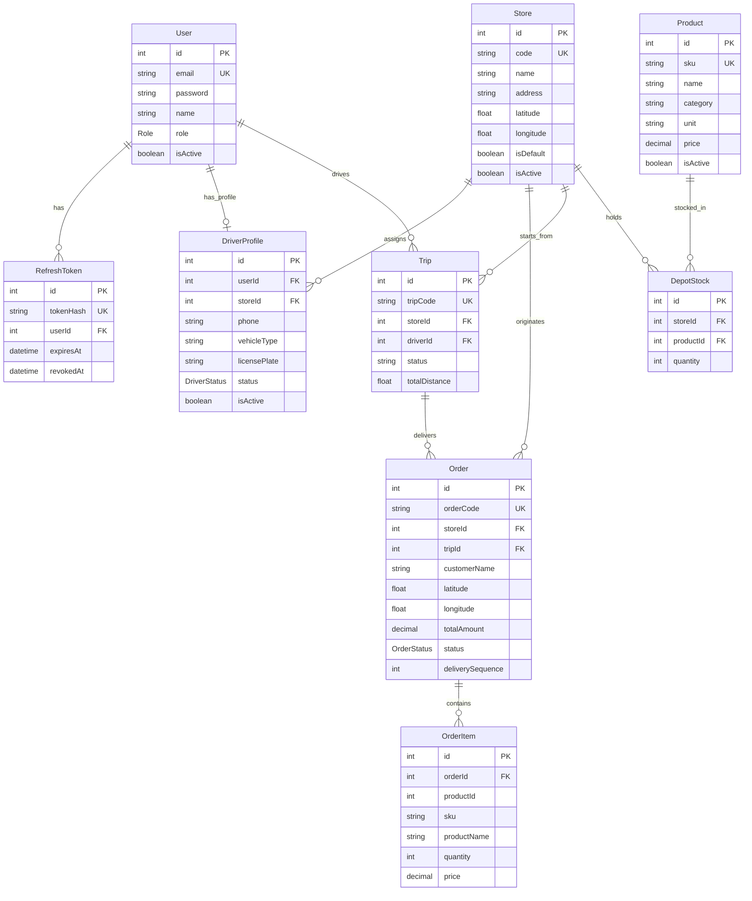

# Kiến Trúc Hệ Thống, Cơ Sở Dữ Liệu & Giao Diện

> Quay lại: [README.md](../README.md) | Xem thêm: [API.md](API.md) · [DEVELOPMENT.md](DEVELOPMENT.md) · [DEPLOY_AZURE.md](../infra/DEPLOY_AZURE.md)

---

## Mục Lục

1. [Ngăn Xếp Công Nghệ (Tech Stack)](#1-ngăn-xếp-công-nghệ-tech-stack)
2. [Sơ Đồ Kiến Trúc Tổng Thể](#2-sơ-đồ-kiến-trúc-tổng-thể)
3. [Cấu Trúc Thư Mục Dự Án](#3-cấu-trúc-thư-mục-dự-án)
4. [Thiết Kế Cơ Sở Dữ Liệu (PostgreSQL & Prisma)](#4-thiết-kế-cơ-sở-dữ-liệu-postgresql--prisma)
5. [Đặc Tả Giao Diện Web Admin Dashboard](#5-đặc-tả-giao-diện-web-admin-dashboard)

---

## 1. Ngăn Xếp Công Nghệ (Tech Stack)

- **Monolithic Backend (`backend/`, `:3000`):**
  - Node.js + TypeScript + Express
  - Prisma ORM + PostgreSQL 15
  - Xác thực JWT Access Token (`15m`) + Refresh Token (`7d`, `HttpOnly` cookie, rotation & reuse detection) + `bcryptjs`
- **Micro-service Solver (`python-solver/`, `:8090`):**
  - Python + FastAPI + Uvicorn
  - Google OR-Tools (`ortools.constraint_solver.pywrapcp`) giải bài toán Vehicle Routing Problem (VRP)
- **Web Frontend SPA (`frontend/`, `:5173`):**
  - React 19 + Vite 6 + TypeScript (hash routing)
  - Meta Astryx Design System (`@astryxdesign/core`, `@astryxdesign/theme-neutral`) + Tailwind CSS v4 (Astryx Tailwind Bridge)
  - Bản đồ số Leaflet (`react-leaflet` v5) với OpenStreetMap (Light) & CARTO Dark Matter (Dark)
- **Hạ tầng & CI/CD (`infra/`, `.github/workflows/`):**
  - Local: Docker Compose (`postgres`, `python-solver`, `backend`, `frontend`)
  - Production: Azure Static Web Apps (`dms-frontend`), Azure Container Apps (`dms-backend`, `dms-solver`), Azure Database for PostgreSQL Flexible Server, Bicep IaC & GitHub Actions OIDC

---

## 2. Sơ Đồ Kiến Trúc Tổng Thể

```text
                       ┌──────────────────────────────────────────────┐
                       │           Web Admin Dashboard (SPA)          │
                       │ (React 19 + Astryx + Tailwind v4 + Leaflet)  │
                       │             http://localhost:5173            │
                       └──────────────────────┬───────────────────────┘
                                              │ HTTP REST (/api/*) + Refresh Cookie
                                              ▼
                       ┌──────────────────────────────────────────────┐
                       │          Node.js Monolith Backend            │
                       │         (Express + TypeScript + Prisma)      │
                       │             http://localhost:3000            │
                       │                                              │
                       │  - JWT Auth, RBAC & Data Scoping             │
                       │  - Order Lifecycle & Per-Depot Inventory     │
                       │  - Dispatcher, Fleet & Trip Builder          │
                       └──────────────┬────────────────┬──────────────┘
                                      │                │
            Prisma Client (SQL queries)                │ HTTP POST /solve-vrp
                                      ▼                ▼
                       ┌────────────────────┐   ┌─────────────────────┐
                       │     PostgreSQL     │   │  Python VRP Solver  │
                       │  (Single Database) │   │  (Google OR-Tools)  │
                       │   localhost:5432   │   │   localhost:8090    │
                       └────────────────────┘   └─────────────────────┘
```

---

## 3. Cấu Trúc Thư Mục Dự Án

```text
doan/
├── README.md                        # Tổng quan dự án, nghiệp vụ cốt lõi & Quick Start
├── AGENTS.md                        # Ngữ cảnh kiến trúc & triển khai cho AI coding agents
├── docker-compose.yml               # Orchestration 4 container local (postgres, solver, backend, frontend)
├── start.sh / stop.sh               # Script khởi động / dừng nhanh hệ thống local
├── docs/                            # Tài liệu kỹ thuật chi tiết
│   ├── ARCHITECTURE.md              # Kiến trúc, sơ đồ ER & đặc tả giao diện (file này)
│   ├── API.md                       # Đặc tả REST API & Python VRP Solver
│   └── DEVELOPMENT.md               # Cài đặt, CLI seed, kiểm chứng cURL & kịch bản demo
├── infra/                           # Azure Bicep IaC (main.bicep, main.bicepparam) & DEPLOY_AZURE.md
├── .github/workflows/               # CI/CD deploy-backend-azure.yml & deploy-frontend-azure.yml
├── backend/                         # Node.js Monolithic Backend (:3000)
│   ├── Dockerfile & docker-entrypoint.sh
│   ├── prisma/
│   │   ├── schema.prisma            # Nguồn chuẩn định nghĩa 9 model & 3 enum PostgreSQL
│   │   ├── migrate-*.sql            # Migration idempotent cho DepotStock & DriverProfile.storeId
│   │   └── seed*.ts                 # CLI seed mẫu (seed.ts, seed-orders.ts, seed-1000-products.ts)
│   └── src/
│       ├── index.ts                 # Entrypoint Express (CORS credentials, cookie-parser, auto-seed)
│       ├── lib/                     # auth.ts, geo.ts (Haversine 5 km), inventory.ts, prisma.ts, seeder.ts
│       ├── middleware/              # auth.middleware.ts (requireAuth, requireRole, loginRateLimiter)
│       ├── controllers/             # auth, user, driver, order, product, store, trip
│       └── routes/                  # Mapping REST routes + RBAC middleware tương ứng
├── python-solver/                   # Micro-service Google OR-Tools VRP (:8090)
│   ├── Dockerfile
│   ├── requirements.txt             # fastapi, uvicorn, ortools, pydantic
│   └── main.py                      # Endpoint POST /solve-vrp & GET /
└── frontend/                        # Web Admin Dashboard SPA (:5173)
    ├── Dockerfile & nginx.conf      # Multi-stage build (Node 22 -> Nginx Alpine) cho local Compose
    ├── public/staticwebapp.config.json # SPA fallback & headers cho Azure Static Web Apps
    ├── AGENTS.md                    # Tài liệu Astryx Design System cho AI coding agents
    └── src/
        ├── main.tsx, index.css, astryx-themes.ts, App.tsx
        ├── context/AuthContext.tsx  # Quản lý phiên đăng nhập & tự động refresh cookie
        ├── types/dms.ts             # Domain types, RBAC helpers, Haversine 5 km & formatters
        ├── api/                     # httpClient.ts (Axios + 401 refresh queue) & dmsApi.ts
        └── components/              # Các trang & modal theo nghiệp vụ (Login, Header, Orders, Trips, Products, Drivers, Depots, Users)
```

---

## 4. Thiết Kế Cơ Sở Dữ Liệu (PostgreSQL & Prisma)

Nguồn định nghĩa đầy đủ (kiểu dữ liệu, index, constraint): **[`backend/prisma/schema.prisma`](../backend/prisma/schema.prisma)**.

### 4.1. Sơ Đồ Quan Hệ Thực Thể (ER Diagram)



### 4.2. Tóm Tắt Các Entity & Enum

**Enums:**
- `Role`: `ADMIN` | `WAREHOUSE` | `DRIVER`
- `OrderStatus`: `NEW` | `PICKING` | `PACKED` | `DELIVERING` | `COMPLETED` | `FAILED`
- `DriverStatus`: `AVAILABLE` | `ON_DELIVERY` | `OFFLINE`

**Models (9 bảng):**

| Model | Vai trò chính | Ràng buộc / Ghi chú nổi bật |
| :--- | :--- | :--- |
| **`User`** | Tài khoản đăng nhập & phân quyền | `email` unique; `password` lưu bcrypt hash (cost 10) |
| **`RefreshToken`** | Quản lý phiên refresh token | `tokenHash` (SHA-256) unique; cascade delete theo `User`; hỗ trợ rotation & revoke |
| **`DriverProfile`** | Hồ sơ phương tiện & trạng thái tài xế | Quan hệ 1-1 với `User`; bắt buộc gắn 1 `Store` (`storeId`) |
| **`Store`** | Điểm xuất phát / Kho hàng (Depot) | Lưu tọa độ GPS (`latitude`, `longitude`) làm gốc cho VRP; chỉ 1 bản ghi `isDefault = true` |
| **`Product`** | Danh mục sản phẩm toàn hệ thống | `sku` unique; giá bán kiểu `Decimal(10, 2)` |
| **`DepotStock`** | Tồn kho sản phẩm theo từng depot | Composite unique `[storeId, productId]`; trừ/hoàn atomic trong Prisma transaction |
| **`Order`** | Đơn hàng giao chặng cuối | Gắn 1 `Store`; `tripId` & `deliverySequence` (1, 2, 3...) được gán khi vào chuyến |
| **`OrderItem`** | Chi tiết dòng sản phẩm của đơn hàng | Snapshot `productName`, `sku`, `price` từ `Product` tại thời điểm đặt; cascade delete theo `Order` |
| **`Trip`** | Chuyến xe giao hàng | Gắn `Store` & `User` (`driverId`); `status` (`ASSIGNED` \| `IN_TRANSIT` \| `COMPLETED`); `totalDistance` (mét) |

---

## 5. Đặc Tả Giao Diện Web Admin Dashboard

Giao diện SPA (`http://localhost:5173`) xây dựng trên **Meta Astryx Design System** + **Tailwind CSS v4** (qua `@astryxdesign/core/tailwind-theme.css` và thứ tự `@layer` chuẩn trong `src/index.css`), hỗ trợ **Light / System / Dark mode** đồng bộ giữa UI và bản đồ Leaflet.

### 5.1. Đăng Nhập & Thanh Điều Hướng (`LoginPage.tsx`, `Header.tsx`, `ChangePasswordModal.tsx`)
- **Auth Gate:** Yêu cầu đăng nhập bằng Email & Mật khẩu; tự động khôi phục phiên khi tải lại trang qua `POST /api/auth/refresh` (`AuthContext.tsx` + `httpClient.ts` có hàng đợi retry khi gặp `401`). Ở môi trường phát triển (`import.meta.env.DEV`), màn hình đăng nhập có nút điền nhanh tài khoản demo (`Admin`, `Kho`, `Tài xế`).
- **Điều hướng theo phân quyền (`SegmentedControl`):**
  - `ADMIN`: Thấy đủ 6 trang (**Đơn hàng**, **Chuyến xe**, **Sản phẩm**, **Tài xế**, **Điểm xuất phát**, **Tài khoản**).
  - `WAREHOUSE`: Thấy 4 trang (**Đơn hàng**, **Chuyến xe**, **Sản phẩm**, **Điểm xuất phát**).
  - `DRIVER`: Chỉ thấy 2 trang (**Đơn hàng**, **Chuyến xe**) giới hạn theo chuyến của mình.
- **Tiện ích Header:** Chuyển giao diện **Sáng / Hệ thống / Tối** (lưu `localStorage`), nút **Tạo đơn mới** (`ADMIN`), hồ sơ người dùng, **Đổi mật khẩu** và **Đăng xuất**.

### 5.2. Trang Quản Lý Đơn Hàng (`#orders`, `OrderTable.tsx` & các Modal)
- **Bảng đơn hàng toàn chiều rộng:** Mặc định sắp xếp `createdAt DESC`, tìm kiếm nhanh (mã đơn, khách hàng, SĐT, địa chỉ, mã chuyến, tài xế) và lọc theo 6 trạng thái.
- **Thao tác hàng loạt (Mass Actions):** Chọn nhiều đơn bằng checkbox (`indeterminate` hỗ trợ chọn tất cả), thanh công cụ ngữ cảnh tự đếm số đơn hợp lệ theo vai trò:
  - `ADMIN`: Nhặt hàng, Đóng gói xong, Gán tài xế (`BulkAssignDriverModal.tsx`), Tạo chuyến tối ưu (`CreateTripModal.tsx`), Bỏ gán tài xế, Giao thành công / Thất bại.
  - `WAREHOUSE`: Bắt đầu nhặt hàng, Đóng gói xong.
  - `DRIVER`: Thao tác xác nhận giao từng đơn thuộc chuyến được gán.
- **Hộp thoại Tạo/Sửa Đơn Hàng (`OrderFormModal.tsx` — `ADMIN`):** Chọn depot xuất phát, bản đồ mini Leaflet có vòng tròn **5 km** (chặn cứng lưu nếu > 5 km), tìm sản phẩm theo tồn kho thực tế tại depot đang chọn (cảnh báo và chặn nếu vượt tồn) và tự tính tổng tiền.
- **Hộp thoại Gán Tài Xế (`AssignDriverModal.tsx` — `ADMIN`):** Chỉ hiển thị tài xế thuộc đúng depot của đơn (ưu tiên `AVAILABLE` trước `ON_DELIVERY`), hỗ trợ đổi hoặc bỏ gán tài xế.

### 5.3. Trang Quản Lý Chuyến Xe (`#trips`, `TripManagementPage.tsx`, `RouteMap.tsx` & các Modal)
- **4 thẻ KPI:** Tổng chuyến, Chờ xuất phát (`ASSIGNED`), Đang giao (`IN_TRANSIT`), Hoàn thành (`COMPLETED`).
- **Bố cục Master-Detail 2 cột:**
  - **Cột trái:** Tìm kiếm, lọc trạng thái chuyến, nút **Tạo chuyến mới** (`ADMIN` — mở `CreateTripModal.tsx` chọn depot, tài xế cùng depot, đơn `PACKED` ≤ 5 km để gọi OR-Tools) và danh sách thẻ chuyến.
  - **Cột phải:** `RouteMap.tsx` hiển thị depot (`🏪`), marker đánh số thứ tự dừng **`1, 2, 3...`** và đường nối **Polyline**, kèm thanh thao tác vòng đời:
    - `ADMIN`: Toàn quyền tạo chuyến, bắt đầu giao, đổi tài xế (`ReassignTripDriverModal.tsx`), tối ưu lại (OR-Tools), hủy chuyến, xác nhận giao/thất bại từng điểm dừng.
    - `WAREHOUSE`: Chỉ xem danh sách chuyến và bản đồ lộ trình.
    - `DRIVER`: Xem chuyến của mình, bấm **Bắt đầu giao** (`IN_TRANSIT`) và xác nhận **Giao xong / Thất bại** từng điểm dừng.

### 5.4. Trang Quản Lý Sản Phẩm (`#products`, `ProductManagementPage.tsx`, `ProductFormModal.tsx`)
- **4 thẻ KPI:** Tổng sản phẩm, Đang kinh doanh, Sắp hết hàng (`<= 10`), Tổng tồn kho (cập nhật theo depot đang lọc).
- **Tìm kiếm, Lọc & Phân trang server:** Debounce `250ms`, lọc theo Depot (`Tất cả depot` hoặc từng depot) và danh mục; khi xem tất cả depot sẽ hiển thị chi tiết phân bổ theo từng mã depot.
- **Phân quyền:** `ADMIN` toàn quyền CRUD (nhập tồn kho theo từng depot); `WAREHOUSE` chỉ xem.

### 5.5. Trang Quản Lý Tài Xế (`#drivers`, `DriverManagementPage.tsx`, `DriverFormModal.tsx` — `ADMIN` only)
- **4 thẻ KPI:** Tổng tài xế, Đang sẵn sàng (`AVAILABLE`), Đang giao (`ON_DELIVERY`), Ngừng hoạt động.
- **Bảng danh sách & CRUD:** Hiển thị depot phụ trách, chuyến đang chạy (`TRIP-...`), tổng số chuyến; tìm kiếm/lọc theo depot, trạng thái, loại xe; phân trang server. Bắt buộc chọn depot khi tạo/sửa và tự khóa đổi depot / khóa xóa nếu tài xế đang có chuyến hoạt động.

### 5.6. Trang Quản Lý Điểm Xuất Phát (`#depots`, `DepotManagementPage.tsx`, `DepotFormModal.tsx`, `DepotInventoryModal.tsx`)
- **4 thẻ KPI & Bản đồ tổng quan Leaflet:** Hiển thị toàn bộ depot (nổi bật kho mặc định ⭐); click để focus và xem vùng phủ **5 km**.
- **Tồn kho từng Depot (`DepotInventoryModal.tsx`):** `ADMIN` và `WAREHOUSE` xem, lọc (`Còn hàng`, `Sắp hết`, `Hết hàng`) và cập nhật nhanh hàng loạt tồn kho tại từng depot.
- **CRUD Depot:** Chỉ `ADMIN` được thêm/sửa (chọn tọa độ trực tiếp trên bản đồ), đặt mặc định, bật/tắt hoạt động và xóa (chặn xóa kho mặc định hoặc kho còn đơn/chuyến/tài xế).

### 5.7. Trang Quản Lý Tài Khoản (`#users`, `UserManagementPage.tsx`, `UserFormModal.tsx`, `ResetPasswordModal.tsx` — `ADMIN` only)
- **4 thẻ KPI:** Tổng tài khoản, Đang hoạt động, Phân bổ vai trò, Đã vô hiệu hóa.
- **Quản trị vòng đời tài khoản:** Tạo/sửa tài khoản & vai trò, bật/tắt trạng thái (tự thu hồi phiên cũ khi vô hiệu hóa hoặc đổi vai trò), đặt lại mật khẩu (`ResetPasswordModal.tsx`) và xóa tài khoản chưa có lịch sử chuyến xe (chặn tự khóa/tự xóa chính mình).
