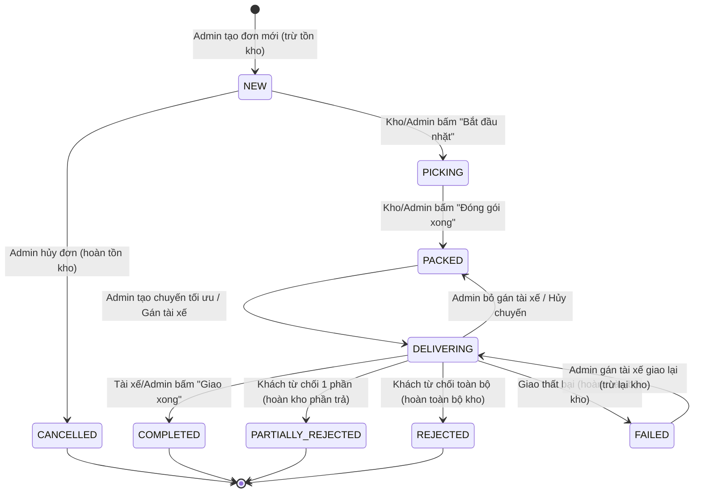
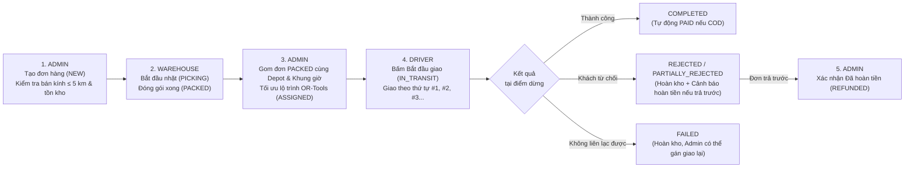
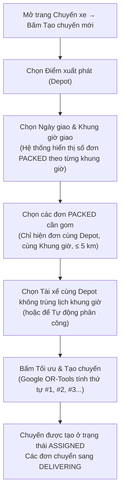

# Hướng Dẫn Sử Dụng Hệ Thống Quản Lý Giao Hàng (DMS)

Tài liệu này hướng dẫn chi tiết cách vận hành hệ thống **Delivery Management System (DMS)** theo từng vai trò người dùng (**Quản trị & Điều phối**, **Nhân viên Kho**, **Tài xế Giao hàng**), kèm kịch bản thực hành từ đầu đến cuối, bảng tra cứu trạng thái và hướng dẫn xử lý sự cố thường gặp.

---

## Mục Lục

1. [Giới Thiệu & Đăng Nhập Nhanh](#1-giới-thiệu--đăng-nhập-nhanh)
2. [Tổng Quan Vòng Đời Đơn Hàng & Phân Quyền](#2-tổng-quan-vòng-đời-đơn-hàng--phân-quyền)
3. [Thao Tác Chung Cho Mọi Vai Trò](#3-thao-tác-chung-cho-mọi-vai-trò)
4. [Hướng Dẫn Dành Cho Quản Trị & Điều Phối (`ADMIN`)](#4-hướng-dẫn-dành-cho-quản-trị--điều-phối-admin)
5. [Hướng Dẫn Dành Cho Nhân Viên Kho (`WAREHOUSE`)](#5-hướng-dẫn-dành-cho-nhân-viên-kho-warehouse)
6. [Hướng Dẫn Dành Cho Tài Xế Giao Hàng (`DRIVER`)](#6-hướng-dẫn-dành-cho-tài-xế-giao-hàng-driver)
7. [Kịch Bản Vận Hành Mẫu Từ Đầu Đến Cuối (End-to-End Walkthrough)](#7-kịch-bản-vận-hành-mẫu-từ-đầu-đến-cuối-end-to-end-walkthrough)
8. [Bảng Tra Cứu Nhanh (Trạng Thái, Thanh Toán, Khung Giờ & Lý Do Từ Chối)](#8-bảng-tra-cứu-nhanh-trạng-thái-thanh-toán-khung-giờ--lý-do-từ-chối)
9. [Xử Lý Sự Cố & Câu Hỏi Thường Gặp (Troubleshooting & FAQ)](#9-xử-lý-sự-cố--câu-hỏi-thường-gặp-troubleshooting--faq)

---

## 1. Giới Thiệu & Đăng Nhập Nhanh

**DMS Dashboard** là ứng dụng web quản lý toàn bộ quy trình xử lý đơn hàng tại kho và giao hàng chặng cuối (Last-Mile Delivery) theo mô hình đa kho xuất phát (**Multi-Depot**), tích hợp thuật toán tối ưu lộ trình **Google OR-Tools VRP** trên bản đồ số.

> [!NOTE]
> Nếu bạn cần cài đặt hoặc khởi chạy hệ thống trên máy cá nhân (Docker / Local), vui lòng xem hướng dẫn kỹ thuật tại [docs/DEVELOPMENT.md](./DEVELOPMENT.md).

### 1.1. Tài khoản mẫu để trải nghiệm

Tất cả tài khoản mẫu dùng chung mật khẩu mặc định **`123456`**:

| Vai trò | Tên hiển thị | Email đăng nhập | Phạm vi công việc chính |
| :--- | :--- | :--- | :--- |
| **Quản trị & Điều phối (`ADMIN`)** | Quản lý / Điều phối | `admin@dms.vn` | Toàn quyền: tạo/sửa/hủy đơn, tối ưu chuyến xe, quản lý kho, sản phẩm, tài xế, tài khoản |
| **Nhân viên Kho (`WAREHOUSE`)** | Nhân viên Kho | `linhdn@dms.vn` | Tiếp nhận đơn `NEW`, nhặt hàng (`PICKING`), đóng gói (`PACKED`), cập nhật tồn kho depot |
| **Tài xế Giao hàng (`DRIVER`)** | Tài xế Giao hàng | `luannv@dms.vn` *(cùng `binhtq`, `cuonglm`, `dungpt`, `hungvt` `@dms.vn`)* | Nhận chuyến được gán, xuất phát giao theo thứ tự điểm dừng `#1, #2...`, xác nhận giao xong / khách từ chối / thất bại |

> [!TIP]
> Khi chạy ở môi trường phát triển (`DEV`), màn hình **Đăng nhập** có sẵn 3 nút **Tài khoản demo nhanh** (`Admin`, `Kho`, `Tài xế`) giúp điền sẵn email và mật khẩu chỉ với 1 cú nhấp chuột.

### 1.2. Các quy tắc nghiệp vụ cốt lõi cần nhớ

- **Bán kính giao hàng tối đa ≤ 5 km:** Khoảng cách đường chim bay (Haversine) từ kho xuất phát (Depot) đến địa chỉ khách hàng không được vượt quá **5 km**. Mọi thao tác tạo đơn, sửa địa chỉ hoặc gom chuyến vượt quá 5 km đều bị hệ thống chặn cứng.
- **Tồn kho quản lý riêng theo từng Depot:** Mỗi kho có tồn kho riêng cho từng sản phẩm (`DepotStock`). Tồn kho được **trừ ngay khi tạo đơn** và **tự động hoàn lại** khi đơn bị hủy (`CANCELLED`), giao thất bại (`FAILED`) hoặc khách từ chối nhận hàng (`REJECTED` / `PARTIALLY_REJECTED`).
- **11 khung giờ giao hàng mỗi ngày:** Mọi đơn hàng và chuyến xe đều gắn với một cặp **(Ngày giao, Khung giờ giao)** gồm 11 khung giờ từ **`09:00 - 10:00`** đến **`19:00 - 20:00`** (múi giờ Việt Nam `Asia/Ho_Chi_Minh`).
- **Gom chuyến đồng nhất & chống trùng lịch tài xế:** Một chuyến xe chỉ chứa các đơn **cùng 1 Depot** và **cùng 1 (Ngày giao, Khung giờ)**. Một tài xế thuộc **1 Depot cố định**, không thể nhận quá **1 chuyến đang hoạt động** (`ASSIGNED` hoặc `IN_TRANSIT`) trong cùng một khung giờ, nhưng có thể nhận nhiều chuyến ở các khung giờ khác nhau trong ngày.
- **Hỗ trợ đa phương thức thanh toán:** Hỗ trợ `COD`, `Thẻ CC`, `MoMo`, `Chuyển khoản`, `ZaloPay`, `VNPay`. Tổng tiền thu hộ (`Tổng COD`) trên chuyến xe chỉ cộng các đơn **COD chưa thanh toán**.

---

## 2. Tổng Quan Vòng Đời Đơn Hàng & Phân Quyền

### 2.1. Sơ đồ vòng đời đơn hàng (9 trạng thái)

### 2.2. Luồng phối hợp giữa 3 vai trò

### 2.3. Ma trận phân quyền theo màn hình & chức năng

| Màn hình / Chức năng | Quản trị (`ADMIN`) | Nhân viên Kho (`WAREHOUSE`) | Tài xế (`DRIVER`) |
| :--- | :---: | :---: | :---: |
| **Trang `Đơn hàng`** — Phạm vi xem | Tất cả đơn hàng | Tất cả đơn hàng | Chỉ đơn thuộc chuyến của mình |
| **Đơn hàng** — Tạo mới / Chỉnh sửa / Cập nhật thanh toán | Có | Không | Không |
| **Đơn hàng** — Hủy đơn (`NEW` → `CANCELLED`) | Có (đơn lẻ & hàng loạt) | Không | Không |
| **Đơn hàng** — Nhặt hàng (`NEW` → `PICKING`) & Đóng gói (`PICKING` → `PACKED`) | Có (đơn lẻ, hàng loạt & Đóng gói nhanh) | Có (đơn lẻ, hàng loạt & Đóng gói nhanh) | Không |
| **Đơn hàng** — Xác nhận Giao xong / Khách từ chối / Giao thất bại | Có | Không | Chỉ đơn thuộc chuyến của mình |
| **Trang `Chuyến xe`** — Phạm vi xem | Tất cả chuyến xe | Tất cả chuyến xe (chỉ xem) | Chỉ chuyến được gán |
| **Chuyến xe** — Tạo chuyến tối ưu / Đổi tài xế / Tối ưu lại / Hủy chuyến | Có | Không | Không |
| **Chuyến xe** — Bắt đầu giao (`ASSIGNED` → `IN_TRANSIT`) | Có | Không | Chỉ chuyến được gán |
| **Trang `Sản phẩm`** — Xem danh mục & tồn kho | Có | Có (chỉ xem) | Không truy cập |
| **Sản phẩm** — Thêm / Sửa / Ngừng bán / Xóa | Có | Không | Không truy cập |
| **Trang `Điểm xuất phát`** — Xem bản đồ & Cập nhật tồn kho Depot | Có | Có | Không truy cập |
| **Điểm xuất phát** — Thêm / Sửa / Xóa / Đặt mặc định | Có | Không | Không truy cập |
| **Trang `Tài xế`** — Quản lý đội ngũ & phương tiện | Có | Không truy cập | Không truy cập |
| **Trang `Tài khoản`** — Quản lý người dùng & đặt lại mật khẩu | Có | Không truy cập | Không truy cập |

---

## 3. Thao Tác Chung Cho Mọi Vai Trò

### 3.1. Đăng nhập & Đăng xuất

1. Mở địa chỉ ứng dụng trên trình duyệt.
2. Tại màn hình **DMS Dashboard — Xác thực tài khoản**, nhập **Email** và **Mật khẩu** (có thể bấm biểu tượng con mắt để hiện/ẩn mật khẩu).
3. Bấm **Đăng nhập**.
4. Để đăng xuất, bấm nút **Đăng xuất** (biểu tượng mũi tên thoát) ở góc trên bên phải thanh tiêu đề.

### 3.2. Làm quen với thanh điều hướng (Header)

Thanh tiêu đề cố định phía trên gồm:
- **Thanh chuyển trang:** Hiển thị các mục mà vai trò của bạn có quyền truy cập kèm bộ đếm số lượng trực tiếp: `Đơn hàng`, `Chuyến xe`, `Sản phẩm`, `Tài xế`, `Điểm xuất phát`, `Tài khoản`.
- **Nút `Tạo đơn mới`** *(chỉ hiện với `ADMIN`)*: Mở nhanh biểu mẫu tạo đơn từ bất kỳ trang nào.
- **Thông tin tài khoản:** Hiển thị tên, email của bạn cùng 2 nút biểu tượng **Đổi mật khẩu** (hình chìa khóa) và **Đăng xuất**.

### 3.3. Đổi mật khẩu cá nhân

1. Bấm biểu tượng chìa khóa (**Đổi mật khẩu**) ở góc trên bên phải Header.
2. Nhập **Mật khẩu hiện tại**, **Mật khẩu mới** và **Xác nhận mật khẩu mới**.
3. Bấm lưu để cập nhật. Hệ thống thông báo khi đổi mật khẩu thành công.

### 3.4. Sử dụng bộ lọc & tùy chỉnh cột bảng Đơn hàng

Tại trang **Đơn hàng**, bạn có thể kết hợp linh hoạt nhiều công cụ tìm kiếm:
- **Ô tìm kiếm:** Tìm nhanh theo mã đơn (`ORD-...`), tên khách hàng, số điện thoại hoặc mã giao dịch thanh toán (`Mã GD`).
- **Tab trạng thái & Bộ lọc trạng thái:** Chuyển nhanh theo 10 tab (`Tất cả`, `Mới`, `Đang nhặt`, `Đã đóng gói`, `Đang giao`, `Hoàn thành`, `Từ chối 1 phần`, `Khách từ chối`, `Thất bại`, `Đã hủy`) hoặc chọn nhiều trạng thái cùng lúc.
- **Lọc theo lịch giao:** Chọn **Ngày giao hàng** và **Khung giờ giao** (`09:00 - 10:00` … `19:00 - 20:00`).
- **Lọc theo thanh toán:** Chọn **Phương thức thanh toán** và **Trạng thái thanh toán**.
- **Tùy chỉnh cột (`Cột hiển thị`):** Bấm nút `Cột hiển thị (x/y)` để ẩn/hiện các cột mong muốn hoặc bấm **Hiện tất cả** / **Thu gọn**.

---

## 4. Hướng Dẫn Dành Cho Quản Trị & Điều Phối (`ADMIN`)

`ADMIN` chịu trách nhiệm quản lý toàn bộ đơn hàng, tối ưu chuyến xe, vận hành mạng lưới kho (Depot), sản phẩm, tài xế và tài khoản.

### 4.1. Quản lý Đơn hàng (`Đơn hàng`)

#### A. Tạo đơn hàng mới

1. Bấm nút **Tạo đơn mới** trên thanh Header.
2. Điền thông tin trong hộp thoại **Tạo đơn hàng mới**:

| Khu vực | Trường thông tin | Lưu ý nghiệp vụ |
| :--- | :--- | :--- |
| **Điểm xuất phát** | `Kho xuất phát (Depot)` | Mặc định chọn kho mặc định đang hoạt động. Tồn kho sản phẩm sẽ hiển thị và trừ trực tiếp theo kho này. |
| **Thông tin khách hàng** | `Tên khách hàng`, `Số điện thoại`, `Địa chỉ giao hàng` | Bắt buộc nhập đầy đủ. |
| **Tọa độ & Bản đồ** | `Vĩ độ (Latitude)`, `Kinh độ (Longitude)` hoặc nhấp trực tiếp trên bản đồ | Bản đồ hiển thị biểu tượng kho (🏪) và vòng tròn bán kính **5 km**. Nhấp vào bản đồ để ghim tọa độ khách hàng; hệ thống tự tính khoảng cách và cảnh báo nếu vượt quá **5 km**. |
| **Lịch giao hàng** | `Ngày giao hàng`, `Khung giờ giao` | Mặc định là ngày hôm nay và khung giờ hiện tại (từ `09:00 - 10:00` đến `19:00 - 20:00`). Không được chọn ngày trong quá khứ. |
| **Thanh toán** | `Phương thức thanh toán`, `Trạng thái thanh toán`, `Mã giao dịch` (tùy chọn) | Chọn `COD` sẽ tự đặt `Chưa thanh toán`; chọn phương thức online (`MoMo`, `VNPay`, `Thẻ CC`, `Chuyển khoản`, `ZaloPay`) sẽ tự đặt `Đã thanh toán` (có thể chỉnh lại, ví dụ chuyển khoản chờ đối soát là `Chưa thanh toán`). |
| **Sản phẩm** | Tìm kiếm theo tên / SKU → thêm vào bảng chi tiết đơn | Nhập từ khóa và tìm sản phẩm; hệ thống hiển thị tồn kho thực tế tại Depot đang chọn và tự tính tổng tiền đơn hàng. |

3. Bấm nút lưu để tạo đơn. Đơn mới có trạng thái **`NEW`** và tồn kho tại Depot được trừ ngay lập tức.

#### B. Chỉnh sửa đơn hàng

- Bấm biểu tượng cây bút (**Chỉnh sửa đơn hàng**) ở cột thao tác của đơn.
- **Đơn ở trạng thái `NEW`:** Được phép sửa toàn bộ thông tin, bao gồm đổi kho xuất phát, thêm/bớt/đổi số lượng sản phẩm, địa chỉ, ngày/khung giờ giao và thanh toán. Hệ thống tự động hoàn/trừ chênh lệch tồn kho tương ứng.
- **Đơn ở trạng thái `PICKING` hoặc `PACKED`:** Danh sách sản phẩm bị khóa (vì kho đã bắt đầu nhặt/đóng gói), nhưng vẫn sửa được thông tin khách hàng, địa chỉ (trong 5 km), ngày/khung giờ giao và thông tin thanh toán.
- **Đơn từ `DELIVERING` trở đi:** Không cho phép sửa thông tin đơn hàng (riêng trạng thái thanh toán vẫn cập nhật được qua nút thanh toán).

#### C. Cập nhật trạng thái thanh toán & Xác nhận hoàn tiền

- Trên bảng đơn hàng, ở cột **Thanh Toán**, bấm biểu tượng thẻ ngân hàng (**Cập nhật trạng thái thanh toán**).
- Thao tác này dùng được ở **mọi trạng thái đơn hàng**, đặc biệt hữu ích trong 2 tình huống:
  1. Xác nhận đơn chuyển khoản/online đã nhận được tiền (`UNPAID` → `PAID`) và nhập `Mã giao dịch`.
  2. Xử lý các đơn trả trước (`PAID`) đã bị hủy (`CANCELLED`) hoặc khách từ chối (`REJECTED` / `PARTIALLY_REJECTED`) đang hiện nhãn cảnh báo **`Cần hoàn tiền ...`**: sau khi hoàn tiền cho khách, Admin mở hộp thoại này để chuyển trạng thái sang **`Đã hoàn tiền (REFUNDED)`**.

#### D. Hủy đơn hàng (`NEW` → `CANCELLED`)

> [!IMPORTANT]
> Chỉ `ADMIN` mới có quyền hủy đơn và **chỉ áp dụng cho đơn đang ở trạng thái `NEW`**. Đơn đã hủy không bị xóa khỏi lịch sử mà chuyển sang trạng thái kết thúc `CANCELLED`.

- **Hủy đơn lẻ:** Tại dòng đơn `NEW`, bấm biểu tượng vòng tròn gạch chéo màu đỏ (**Hủy đơn hàng**).
- **Hủy hàng loạt:** Tick chọn nhiều đơn trên bảng → trên thanh thao tác hàng loạt, bấm **Hủy đơn (N)** *(các đơn không ở trạng thái `NEW` sẽ tự động được bỏ qua và báo cáo)*.
- Trong hộp thoại xác nhận, nhập **Lý do hủy** (tùy chọn, tối đa 500 ký tự) và xác nhận. Hệ thống sẽ:
  - Chuyển đơn sang `CANCELLED` và lưu thời điểm + lý do hủy.
  - Tự động **hoàn toàn bộ tồn kho** về đúng Depot xuất phát.
  - Hiển thị cảnh báo **`Cần hoàn tiền`** nếu đơn đã thanh toán trước.

#### E. Thao tác hàng loạt (Bulk Actions)

Tick vào ô chọn ở đầu mỗi dòng (hoặc ô chọn tất cả trên tiêu đề bảng) để mở **Thanh thao tác hàng loạt**:
- **`Bắt đầu nhặt (N)`:** Chuyển các đơn `NEW` đã chọn sang `PICKING`.
- **`Đóng gói xong (N)`:** Chuyển các đơn `PICKING` đã chọn sang `PACKED`.
- **`Đóng gói nhanh (N đơn)`** *(nút trên thanh công cụ bảng)*: Chuyển nhanh các đơn `NEW`/`PICKING` sang `PACKED` để sẵn sàng điều phối.
- **`Hủy đơn (N)`:** Hủy hàng loạt các đơn `NEW`.
- **`Bỏ gán tài xế (N)`:** Gỡ các đơn `DELIVERING` khỏi chuyến hiện tại để trả về `PACKED`.
- **`Giao thành công (N)` / `Giao thất bại (N)`:** Xác nhận hàng loạt kết quả giao hàng cho các đơn `DELIVERING`.

---

### 4.2. Điều Phối & Tối Ưu Lộ Trình (`Chuyến xe`)

#### A. Tạo chuyến xe tối ưu mới

1. Chuyển sang trang **Chuyến xe** và bấm **Tạo chuyến mới (N)**.
2. Trong hộp thoại **Tạo Chuyến Xe Mới**:
   - **Chọn điểm xuất phát:** Chọn Depot muốn xuất chuyến.
   - **Ngày giao & Khung giờ giao:** Chọn ngày và khung giờ (menu khung giờ hiển thị sẵn số lượng đơn `PACKED` đang chờ ở mỗi khung giờ).
   - **Chọn tài xế giao hàng:** Chọn 1 tài xế thuộc đúng Depot và **chưa có chuyến hoạt động nào trong khung giờ đó**, hoặc chọn chế độ **Tự động phân công** để hệ thống tự chọn tài xế rảnh phù hợp nhất (ưu tiên tài xế `AVAILABLE` và ít chuyến hoạt động nhất).
   - **Chọn đơn hàng:** Tick chọn các đơn `PACKED` muốn đưa vào chuyến.
3. Xác nhận tạo chuyến. Hệ thống gọi dịch vụ **Google OR-Tools VRP** để sắp xếp thứ tự điểm dừng `#1, #2, #3...` có tổng quãng đường ngắn nhất, vẽ tuyến đường trên bản đồ và chuyển các đơn sang `DELIVERING`.

#### B. Quản lý chuyến xe đang hoạt động

Khi chọn một chuyến ở danh sách bên trái, khung chi tiết bên phải hiển thị bản đồ lộ trình (`RouteMap`), tổng quãng đường, tổng tiền thu hộ (`Tổng COD`), danh sách điểm dừng và các nút điều khiển:

| Nút thao tác | Trạng thái áp dụng | Tác dụng |
| :--- | :--- | :--- |
| **`Bắt đầu giao`** | `ASSIGNED` | Chuyển chuyến sang `IN_TRANSIT` (Admin có thể bấm thay Tài xế nếu cần). |
| **`Đổi tài xế`** | `ASSIGNED`, `IN_TRANSIT` | Mở hộp thoại chuyển chuyến sang tài xế khác cùng Depot và không bị trùng lịch ở khung giờ đó. |
| **`Tối ưu lại lộ trình`** | `ASSIGNED`, `IN_TRANSIT` | Chạy lại thuật toán OR-Tools để tính lại thứ tự điểm dừng cho các đơn còn đang `DELIVERING` (hữu ích khi vừa thêm/bớt đơn trong chuyến). |
| **`Hủy chuyến`** | `ASSIGNED`, `IN_TRANSIT` | Hủy chuyến, trả các đơn chưa hoàn tất (`DELIVERING`) về trạng thái `PACKED` để gom chuyến khác, đồng thời giải phóng tài xế. |

---

### 4.3. Quản lý Điểm Xuất Phát & Tồn Kho (`Điểm xuất phát`)

- **Bản đồ vùng phủ sóng 5 km:** Nhấp vào bất kỳ kho nào trong bảng (hoặc nút xem trên bản đồ) để hiển thị vị trí kho và vòng tròn bán kính giao hàng **5 km** trên bản đồ phía trên.
- **Thêm / Sửa điểm xuất phát:** Bấm **Thêm điểm xuất phát** (hoặc biểu tượng sửa trên từng dòng) để nhập mã kho, tên, địa chỉ, số điện thoại, tọa độ GPS (có thể chọn trực tiếp trên bản đồ) và ghi chú.
- **Đặt làm kho mặc định:** Bấm nút **Đặt làm điểm xuất phát mặc định** trên một kho đang hoạt động. Hệ thống luôn đảm bảo có duy nhất **1 kho mặc định**.
- **Quản lý tồn kho theo Depot:** Bấm biểu tượng kho hàng (**Xem tồn kho \<Tên kho\>**) để mở hộp thoại **Tồn Kho Depot**. Tại đây bạn có thể tìm sản phẩm theo tên/SKU, lọc theo danh mục hoặc mức tồn kho, chỉnh sửa trực tiếp số lượng tồn của nhiều sản phẩm cùng lúc (dòng đã sửa sẽ gắn nhãn `Đã sửa`) và bấm lưu hàng loạt.
- **Xóa điểm xuất phát:** Chỉ xóa được kho **không phải kho mặc định** và **không còn đơn hàng, chuyến xe hay tài xế** gắn liền.

---

### 4.4. Quản lý Danh Mục Sản Phẩm (`Sản phẩm`)

- Xem 4 thẻ tổng quan: tổng sản phẩm, đang bán, sắp hết hàng và tổng tồn kho.
- Lọc danh sách theo **Depot**, **Danh mục** (`Thực phẩm tươi sống`, `Rau củ & Trái cây`, `Thực phẩm khô`, `Sữa & Đồ uống`, `Hóa mỹ phẩm`, `Khác`) hoặc tìm theo tên / SKU.
- **Thêm sản phẩm / Chỉnh sửa:** Bấm **Thêm sản phẩm** (hoặc nút sửa từng dòng), nhập SKU, tên, danh mục, đơn vị tính, giá bán, trạng thái (`Đang bán` / `Ngừng bán`) và thiết lập tồn kho ban đầu cho từng Depot.
- **Bật/tắt kinh doanh & Xóa:** Dùng nút chuyển trạng thái để tạm ngừng bán hoặc nút xóa để gỡ sản phẩm không còn sử dụng.

---

### 4.5. Quản lý Đội Ngũ Tài Xế (`Tài xế`)

- Lọc tài xế theo **Depot**, **Trạng thái** (`Sẵn sàng`, `Đang giao`, `Ngoại tuyến`), **Loại xe** (`Xe máy`, `Xe tải nhỏ`, `Xe van`) hoặc tìm kiếm theo tên, SĐT, email, biển số.
- **Thêm tài xế:** Bấm **Thêm tài xế**, nhập họ tên, email, mật khẩu đăng nhập, SĐT, **Depot trực thuộc**, loại xe, biển số và trạng thái ban đầu. Hệ thống tự động tạo tài khoản đăng nhập có vai trò `DRIVER` gắn với hồ sơ tài xế này.
- **Quy tắc ràng buộc:** Không thể đổi Depot hoặc xóa tài xế khi tài xế đang có chuyến xe ở trạng thái hoạt động (`ASSIGNED` hoặc `IN_TRANSIT`).

---

### 4.6. Quản lý Tài Khoản Người Dùng (`Tài khoản`)

- Xem danh sách toàn bộ tài khoản hệ thống, lọc theo **Vai trò** (`ADMIN`, `WAREHOUSE`, `DRIVER`) và **Trạng thái** (`Đang hoạt động`, `Vô hiệu hóa`).
- **Tạo / Chỉnh sửa tài khoản:** Tạo mới tài khoản `ADMIN` hoặc `WAREHOUSE` (hoặc chỉnh sửa thông tin, bật/tắt trạng thái hoạt động).
- **Đặt lại mật khẩu:** Khi nhân viên quên mật khẩu, bấm biểu tượng chìa khóa (**Đặt lại mật khẩu**) trên dòng tài khoản đó để cấp mật khẩu mới ngay lập tức.

---

## 5. Hướng Dẫn Dành Cho Nhân Viên Kho (`WAREHOUSE`)

Nhân viên Kho phụ trách chuẩn bị hàng hóa cho các đơn mới và duy trì số liệu tồn kho chính xác tại từng Depot.

### 5.1. Quy trình xử lý đơn hàng hằng ngày

1. Mở trang **Đơn hàng** (trang mặc định sau khi đăng nhập).
2. Chọn tab **`Mới (New)`** và lọc theo **Ngày giao hàng** / **Khung giờ giao** gần nhất để ưu tiên xử lý các đơn sắp đến giờ xuất chuyến.
3. **Bước 1 — Nhặt hàng (`NEW` → `PICKING`):**
   - Xem cột **Sản phẩm** để biết danh sách mặt hàng và số lượng cần lấy tại kho.
   - Bấm nút **`Bắt đầu nhặt`** trên từng đơn (hoặc tick chọn nhiều đơn → bấm **`Bắt đầu nhặt (N)`** trên thanh thao tác hàng loạt).
   - Đơn chuyển sang trạng thái **`Đang nhặt (PICKING)`**.
4. **Bước 2 — Kiểm đếm & Đóng gói (`PICKING` → `PACKED`):**
   - Chuyển sang tab **`Đang nhặt (Picking)`**.
   - Sau khi kiểm đủ hàng và đóng gói dán nhãn mã đơn, bấm nút **`Đóng gói xong`** (hoặc tick chọn nhiều đơn → bấm **`Đóng gói xong (N)`**).
   - Đơn chuyển sang trạng thái **`Đã đóng gói (PACKED)`** và hiển thị dòng `Sẵn sàng tạo chuyến` để Điều phối (`ADMIN`) gom chuyến.

> [!TIP]
> Trong giờ cao điểm, bạn có thể bấm nút **`Đóng gói nhanh (N đơn)`** trên thanh công cụ bảng đơn hàng để đẩy nhanh toàn bộ đơn đang ở `NEW`/`PICKING` sang `PACKED` theo đúng quy trình.

### 5.2. Cập nhật tồn kho tại Depot

1. Chuyển sang trang **Điểm xuất phát**.
2. Tìm kho bạn phụ trách và bấm biểu tượng **Xem tồn kho \<Tên kho\>**.
3. Tìm sản phẩm theo tên/SKU hoặc lọc theo mức tồn (hết hàng / sắp hết).
4. Nhập lại số lượng tồn thực tế sau kiểm kê hoặc nhập thêm hàng mới.
5. Bấm nút lưu để cập nhật đồng loạt vào hệ thống.

### 5.3. Tra cứu danh mục & chuyến xe

- **Trang `Sản phẩm`:** Chế độ chỉ xem giúp tra cứu nhanh mã SKU, quy cách, giá và tồn kho phân bổ ở các kho.
- **Trang `Chuyến xe`:** Chế độ chỉ xem giúp kho nắm trước danh sách đơn thuộc từng chuyến xe (`ASSIGNED`) sắp đến lấy hàng theo từng khung giờ.

---

## 6. Hướng Dẫn Dành Cho Tài Xế Giao Hàng (`DRIVER`)

Tài xế chỉ nhìn thấy các **chuyến xe** và **đơn hàng** được phân công trực tiếp cho mình trên 2 trang: **`Chuyến xe`** và **`Đơn hàng`**.

### 6.1. Nhận chuyến & Bắt đầu xuất phát

1. Mở trang **Chuyến xe** và chọn chuyến đang ở trạng thái **`Chờ xuất phát (ASSIGNED)`**.
2. Kiểm tra thông tin chuyến trước khi rời kho:
   - **Điểm xuất phát (Depot)** và **Ngày giao • Khung giờ giao**.
   - **Tổng quãng đường** và **Bản đồ lộ trình** hiển thị thứ tự các điểm dừng tối ưu **`#1, #2, #3...`**.
   - **Tổng COD cần thu hộ** và nhãn thanh toán của từng đơn:
     - Đơn COD: hiển thị số tiền cần thu (`Thu hộ COD: ...₫`).
     - Đơn đã thanh toán online: hiển thị nhãn xanh **`Đã thanh toán (0₫ thu hộ)`** — **không thu tiền mặt của khách**.
     - Đơn online chưa thanh toán: hiển thị nhãn cảnh báo vàng **`Chưa thanh toán`**.
3. Sau khi nhận đủ kiện hàng tại kho, bấm nút **`Bắt đầu giao`**. Chuyến xe chuyển sang trạng thái **`Đang giao hàng (IN_TRANSIT)`**.

### 6.2. Xác nhận kết quả tại từng điểm dừng

Tại mỗi điểm dừng theo thứ tự `#1, #2, #3...` (trên trang **Chuyến xe** hoặc trang **Đơn hàng**), bạn có **3 lựa chọn xử lý**:

#### Lựa chọn 1: Giao thành công (`Giao xong`)
- Bấm nút **`Giao xong`** khi khách nhận đủ hàng (và đã thanh toán đủ tiền mặt nếu là đơn COD).
- Đơn chuyển sang **`Hoàn thành (COMPLETED)`**. Nếu là đơn COD chưa thanh toán, hệ thống tự động đánh dấu thanh toán là **`Đã thanh toán (PAID)`**.

#### Lựa chọn 2: Khách từ chối nhận hàng (`Khách từ chối nhận hàng`)
Áp dụng khi đã gặp khách nhưng khách **từ chối nhận toàn bộ** hoặc **chỉ nhận một phần sản phẩm**:
1. Bấm biểu tượng kiện hàng có dấu X (**Khách từ chối nhận hàng**).
2. Trong hộp thoại **Khách Từ Chối Nhận Hàng**:
   - **Chọn lý do từ chối:** Chọn 1 trong 7 lý do có sẵn (nếu chọn **`Lý do khác`**, bắt buộc nhập mô tả chi tiết vào ô ghi chú).
   - **Chọn số lượng sản phẩm bị từ chối:** Điều chỉnh số lượng khách trả lại cho từng sản phẩm (có nút bấm nhanh **`Từ chối toàn bộ`** hoặc **`Đặt về 0`** để chọn lại từng món). Phải có ít nhất 1 đơn vị sản phẩm bị từ chối.
   - **Kiểm tra phần tóm tắt tự động:** Hệ thống tự tính:
     - Trạng thái kết quả: **`Khách từ chối (REJECTED)`** (nếu từ chối hết) hoặc **`Từ chối một phần (PARTIALLY_REJECTED)`** (nếu khách nhận một phần).
     - **Số tiền trả lại** và **Số tiền COD thực thu** (đối với đơn COD từ chối một phần, chỉ thu đúng số tiền của các sản phẩm khách nhận).
     - Cảnh báo hoàn tiền (nếu khách đã thanh toán online trước).
3. Bấm xác nhận. Tồn kho của các sản phẩm bị từ chối được hoàn ngay về Depot.

> [!WARNING]
> Đơn `REJECTED` và `PARTIALLY_REJECTED` là trạng thái kết thúc, **không thể giao lại**. Hãy kiểm tra kỹ số lượng từng món trước khi xác nhận.

#### Lựa chọn 3: Giao thất bại (`Giao thất bại`)
- Bấm biểu tượng dấu X đỏ (**Giao thất bại**) khi **không liên lạc được với khách**, khách không có mặt tại địa chỉ hoặc không thể bàn giao.
- Đơn chuyển sang **`Giao thất bại (FAILED)`** và toàn bộ tồn kho được hoàn tạm về Depot. Quản trị viên (`ADMIN`) có thể gán tài xế để **giao lại** sau.

### 6.3. Tự động hoàn tất chuyến xe

Khi **toàn bộ điểm dừng** trong chuyến đã được xử lý xong (`COMPLETED`, `PARTIALLY_REJECTED`, `REJECTED`, hoặc `FAILED`), hệ thống sẽ **tự động đóng chuyến** sang trạng thái **`Hoàn thành (COMPLETED)`** và chuyển trạng thái tài xế về **`Sẵn sàng (AVAILABLE)`** (nếu không còn chuyến nào khác đang hoạt động).

---

## 7. Kịch Bản Vận Hành Mẫu Từ Đầu Đến Cuối (End-to-End Walkthrough)

Kịch bản dưới đây minh họa trọn vẹn một ca giao hàng thực tế đi qua cả 3 vai trò:

| Bước | Vai trò đăng nhập | Thao tác thực hiện | Kết quả trên hệ thống |
| :---: | :--- | :--- | :--- |
| **1** | `ADMIN` (`admin@dms.vn`) | Bấm **Tạo đơn mới** → Chọn kho mặc định (`Bến Thành`), ghim địa chỉ khách trong bán kính 5 km, chọn **Ngày hôm nay** & khung giờ **`14:00 - 15:00`**, chọn thanh toán **`COD`**, thêm 2 sản phẩm → Lưu (**Đơn A**). | Đơn A có trạng thái `NEW`, thanh toán `COD • Chưa TT`, tồn kho tại kho `Bến Thành` bị trừ ngay. |
| **2** | `ADMIN` (`admin@dms.vn`) | Tạo tiếp **Đơn B** cùng kho `Bến Thành`, cùng ngày & khung giờ **`14:00 - 15:00`**, chọn phương thức **`Ví MoMo`** (tự động `Đã thanh toán`), thêm 2 sản phẩm (mỗi loại 2 cái) → Lưu. | Đơn B có trạng thái `NEW`, thanh toán `MoMo • Đã TT`. |
| **3** | `WAREHOUSE` (`linhdn@dms.vn`) | Mở trang **Đơn hàng** → Tab `Mới (New)` → Tick chọn Đơn A & Đơn B → Bấm **`Bắt đầu nhặt (2)`** → Sau đó bấm **`Đóng gói xong (2)`**. | Cả 2 đơn lần lượt chuyển `NEW` → `PICKING` → `PACKED` (`Sẵn sàng tạo chuyến`). |
| **4** | `ADMIN` (`admin@dms.vn`) | Mở trang **Chuyến xe** → Bấm **`Tạo chuyến mới`** → Chọn kho `Bến Thành`, ngày hôm nay, khung giờ `14:00 - 15:00`, chọn tài xế `luannv@dms.vn` (thuộc kho `Bến Thành`), chọn Đơn A & Đơn B → Bấm tạo chuyến. | OR-Tools tính thứ tự điểm dừng `#1, #2` ngắn nhất; chuyến có trạng thái `ASSIGNED`; 2 đơn chuyển `DELIVERING`; `Tổng COD` chỉ bằng tiền của Đơn A (Đơn B thu hộ `0₫`). |
| **5** | `DRIVER` (`luannv@dms.vn`) | Mở trang **Chuyến xe** → Chọn chuyến vừa nhận → Bấm **`Bắt đầu giao`**. | Chuyến chuyển sang `IN_TRANSIT`. |
| **6** | `DRIVER` (`luannv@dms.vn`) | Tại điểm dừng **Đơn A**: thu tiền mặt COD và bấm **`Giao xong`**. | Đơn A chuyển `COMPLETED` và tự động cập nhật thanh toán thành `Đã TT`. |
| **7** | `DRIVER` (`luannv@dms.vn`) | Tại điểm dừng **Đơn B**: khách trả lại 1 sản phẩm bị móp → Bấm **`Khách từ chối nhận hàng`**, chọn lý do `Hàng bị hỏng / móp méo / quá hạn`, nhập số lượng trả `1` → Xác nhận. | Đơn B chuyển `PARTIALLY_REJECTED`, hoàn 1 đơn vị tồn kho về kho `Bến Thành`, hiện nhãn **`Cần hoàn tiền`**. Chuyến xe tự động đóng **`COMPLETED`**. |
| **8** | `ADMIN` (`admin@dms.vn`) | Mở trang **Đơn hàng** → Tab `Từ chối 1 phần` → Ở Đơn B, bấm biểu tượng thẻ ngân hàng (**Cập nhật trạng thái thanh toán**) → Chọn **`Đã hoàn tiền (REFUNDED)`** và ghi mã hoàn tiền → Lưu. | Đơn B hoàn tất đối soát tài chính, nhãn cảnh báo `Cần hoàn tiền` biến mất. |

---

## 8. Bảng Tra Cứu Nhanh (Trạng Thái, Thanh Toán, Khung Giờ & Lý Do Từ Chối)

### 8.1. Trạng thái Đơn hàng (`OrderStatus`)

| Mã trạng thái | Nhãn hiển thị trên UI | Ý nghĩa & Tác động tồn kho | Có phải trạng thái kết thúc? |
| :--- | :--- | :--- | :---: |
| `NEW` | `Mới tạo (NEW)` | Đơn vừa tạo, đã trừ tồn kho tại Depot. Có thể sửa toàn bộ hoặc hủy đơn. | Không |
| `PICKING` | `Đang nhặt (PICKING)` | Nhân viên kho đang lấy hàng. Không thể sửa danh sách sản phẩm hoặc hủy. | Không |
| `PACKED` | `Đã đóng gói (PACKED)` | Hàng đã đóng gói xong, sẵn sàng gom vào chuyến xe tối ưu. | Không |
| `DELIVERING` | `Đang giao (DELIVERING)` | Đã gán vào chuyến xe và gán cho tài xế. | Không |
| `COMPLETED` | `Hoàn thành (COMPLETED)` | Giao đủ hàng thành công. Tự động đánh dấu `PAID` nếu là đơn COD. | **Có** |
| `PARTIALLY_REJECTED` | `Từ chối một phần (PARTIAL)` | Khách nhận một phần, trả lại một phần. Hoàn tồn kho đúng số lượng trả; COD tự đánh dấu `PAID` cho phần thực nhận. | **Có** |
| `REJECTED` | `Khách từ chối (REJECTED)` | Khách từ chối toàn bộ đơn. Hoàn toàn bộ tồn kho; COD thu `0₫`. | **Có** |
| `FAILED` | `Giao thất bại (FAILED)` | Không giao được hàng (vắng mặt/không liên lạc được). Hoàn tồn kho; Admin có thể gán giao lại. | Tạm dừng *(giao lại được)* |
| `CANCELLED` | `Đã hủy (CANCELLED)` | Admin hủy đơn khi còn ở `NEW`. Hoàn toàn bộ tồn kho về Depot. | **Có** |

### 8.2. Trạng thái Chuyến xe (`TripStatus`) & Tài xế (`DriverStatus`)

| Loại | Mã trạng thái | Nhãn hiển thị | Ý nghĩa |
| :--- | :--- | :--- | :--- |
| **Chuyến xe** | `ASSIGNED` | `Chờ xuất phát (ASSIGNED)` | Đã gom đơn và tối ưu lộ trình, chờ tài xế nhận hàng và bấm `Bắt đầu giao`. |
| **Chuyến xe** | `IN_TRANSIT` | `Đang giao hàng (IN_TRANSIT)` | Tài xế đang di chuyển giao các điểm dừng trên tuyến. |
| **Chuyến xe** | `COMPLETED` | `Hoàn thành (COMPLETED)` | Toàn bộ đơn trong chuyến đã có kết quả giao hàng; chuyến tự động đóng. |
| **Tài xế** | `AVAILABLE` | `Sẵn sàng (AVAILABLE)` | Tài xế đang rảnh, sẵn sàng nhận chuyến (ưu tiên khi tự động phân công). |
| **Tài xế** | `ON_DELIVERY` | `Đang giao hàng (ON_DELIVERY)` | Tài xế đang có chuyến hoạt động (vẫn có thể nhận thêm chuyến ở **khung giờ khác**). |
| **Tài xế** | `OFFLINE` | `Ngoại tuyến (OFFLINE)` | Tài xế đang nghỉ/tạm ngưng, không nằm trong danh sách tự động phân công. |

### 8.3. Phương thức & Trạng thái Thanh toán

| Phương thức (`PaymentMethod`) | Nhãn UI | Trạng thái mặc định khi tạo đơn | Quy tắc hiển thị cho Tài xế |
| :--- | :--- | :--- | :--- |
| `COD` | `COD (Tiền mặt khi giao)` | `Chưa thanh toán (UNPAID)` | Cộng vào `Tổng COD` cần thu hộ (trừ phần bị từ chối nếu có). |
| `CREDIT_CARD` | `Thẻ tín dụng / Ghi nợ (CC)` | `Đã thanh toán (PAID)` | Nếu `PAID`: hiện `Đã thanh toán (0₫ thu hộ)`. Nếu `UNPAID`: hiện cảnh báo `Chưa thanh toán`. |
| `MOMO` | `Ví MoMo` | `Đã thanh toán (PAID)` | Như trên |
| `BANK_TRANSFER` | `Chuyển khoản ngân hàng` | `Đã thanh toán (PAID)` | Như trên *(Admin có thể chọn `UNPAID` khi chờ đối soát)* |
| `ZALOPAY` | `Ví ZaloPay` | `Đã thanh toán (PAID)` | Như trên |
| `VNPAY` | `VNPay QR` | `Đã thanh toán (PAID)` | Như trên |

| Trạng thái (`PaymentStatus`) | Nhãn UI | Ý nghĩa |
| :--- | :--- | :--- |
| `UNPAID` | `Chưa thanh toán` (`Chưa TT`) | Chưa thu tiền (mặc định của COD hoặc đơn chuyển khoản chờ xác nhận). |
| `PAID` | `Đã thanh toán` (`Đã TT`) | Đã thanh toán (tự động cập nhật khi giao thành công đơn COD, hoặc khi đơn online đã thanh toán trước). |
| `REFUNDED` | `Đã hoàn tiền` (`Hoàn tiền`) | Admin xác nhận đã hoàn tiền cho khách sau khi đơn trả trước bị hủy hoặc bị từ chối. |

### 8.4. 11 Khung giờ giao hàng hằng ngày

Hệ thống chia ngày giao hàng thành **11 khung giờ cố định** (giờ Việt Nam, `UTC+7`):

`09:00 - 10:00` • `10:00 - 11:00` • `11:00 - 12:00` • `12:00 - 13:00` • `13:00 - 14:00` • `14:00 - 15:00` • `15:00 - 16:00` • `16:00 - 17:00` • `17:00 - 18:00` • `18:00 - 19:00` • `19:00 - 20:00`

### 8.5. 7 Lý do khách từ chối nhận hàng (`RejectionReason`)

| Mã lý do | Nhãn hiển thị trên UI | Ghi chú bắt buộc? |
| :--- | :--- | :---: |
| `NOT_AS_DESCRIBED` | `Hàng không giống mô tả / hình ảnh` | Không |
| `WRONG_SIZE_OR_VARIANT` | `Sai kích thước / phân loại / quy cách` | Không |
| `DAMAGED_OR_EXPIRED` | `Hàng bị hỏng / móp méo / quá hạn` | Không |
| `WRONG_OR_MISSING_ITEM` | `Giao sai sản phẩm / thiếu hàng` | Không |
| `LATE_DELIVERY` | `Giao trễ khung giờ hẹn` | Không |
| `CUSTOMER_CHANGED_MIND` | `Khách đổi ý không muốn nhận` | Không |
| `OTHER` | `Lý do khác` | **Bắt buộc** (tối đa 500 ký tự) |

---

## 9. Xử Lý Sự Cố & Câu Hỏi Thường Gặp (Troubleshooting & FAQ)

### Lỗi: *"Địa chỉ giao hàng vượt quá bán kính 5 km từ kho xuất phát"*
- **Nguyên nhân:** Khoảng cách từ tọa độ kho đang chọn đến vị trí khách hàng lớn hơn **5 km**.
- **Cách khắc phục:** Kiểm tra lại ghim vị trí khách hàng trên bản đồ trong biểu mẫu tạo/sửa đơn, hoặc đổi sang một **Kho xuất phát (Depot)** khác gần khách hàng hơn (nằm trong vòng tròn 5 km).

### Lỗi: *"Không đủ tồn kho tại depot"* khi tạo hoặc sửa đơn
- **Nguyên nhân:** Sản phẩm có thể còn hàng ở kho khác, nhưng tại **Depot đang chọn** số lượng tồn nhỏ hơn số lượng đặt.
- **Cách khắc phục:** Mở **Điểm xuất phát** → **Xem tồn kho** để kiểm tra và cập nhật tồn kho tại Depot đó, hoặc chọn Depot khác còn hàng (trong bán kính 5 km).

### Không thấy đơn hàng `PACKED` hoặc không chọn được Tài xế khi tạo chuyến
- **Nguyên nhân phổ biến:**
  1. Đơn hàng thuộc **Depot khác**, **Ngày giao khác** hoặc **Khung giờ giao khác** với bộ lọc đang chọn trong hộp thoại `Tạo Chuyến Xe Mới`.
  2. Tài xế thuộc **Depot khác** hoặc **đã có chuyến hoạt động** (`ASSIGNED` / `IN_TRANSIT`) trong đúng khung giờ đó, hoặc đang ở trạng thái `OFFLINE`.
- **Cách khắc phục:** Kiểm tra lại bộ lọc `Điểm xuất phát` + `Ngày giao` + `Khung giờ giao` ở đầu hộp thoại; chọn tài xế khác rảnh trong khung giờ đó, hoặc chọn chế độ **Tự động phân công**.

### Không thể sửa danh sách sản phẩm hoặc không thấy nút `Hủy đơn`
- **Nguyên nhân:**
  - Nút **Hủy đơn** chỉ xuất hiện cho vai trò `ADMIN` khi đơn còn ở trạng thái **`NEW`**.
  - Danh sách sản phẩm bị khóa ngay khi đơn đã chuyển sang **`PICKING`** hoặc **`PACKED`** để tránh lệch hàng kho đang nhặt.
- **Cách khắc phục:** Chỉ chỉnh sửa sản phẩm/hủy đơn trước khi kho bấm `Bắt đầu nhặt`. Nếu đơn đã giao và khách không nhận, hãy xử lý bằng **Khách từ chối nhận hàng** hoặc **Giao thất bại**.

### Không thể xóa Điểm xuất phát (Depot) hoặc Tài xế
- **Nguyên nhân:**
  - Không thể xóa **kho mặc định** hoặc kho vẫn còn đơn hàng, chuyến xe, tài xế gắn liền.
  - Không thể xóa hoặc đổi kho cho tài xế đang có chuyến `ASSIGNED` / `IN_TRANSIT`.
- **Cách khắc phục:** Chuyển kho mặc định sang kho khác trước (nếu muốn tắt kho cũ, dùng nút **Ngừng hoạt động** thay vì xóa). Với tài xế, hãy hoàn tất hoặc chuyển giao (`Đổi tài xế`) các chuyến đang chạy trước.

### Hệ thống phản hồi chậm ở lần truy cập đầu tiên (môi trường Cloud / Azure)
- **Nguyên nhân:** Trên môi trường Azure, các dịch vụ `dms-backend` và `dms-solver` tự động giảm về `0` bản sao khi không có người dùng để tiết kiệm chi phí (**Cold Start**).
- **Cách khắc phục:** Chờ khoảng **5–15 giây** cho lần đăng nhập hoặc lần tối ưu lộ trình đầu tiên sau thời gian dài không sử dụng; các thao tác tiếp theo sẽ phản hồi bình thường.

### Quên mật khẩu đăng nhập
- **Cách khắc phục:** Liên hệ Quản trị viên (`ADMIN`). Quản trị viên vào trang **Tài khoản**, tìm tài khoản của bạn và bấm biểu tượng chìa khóa (**Đặt lại mật khẩu**) để cấp mật khẩu mới. Sau khi đăng nhập lại, bạn nên dùng nút **Đổi mật khẩu** trên thanh Header để đặt mật khẩu riêng.
